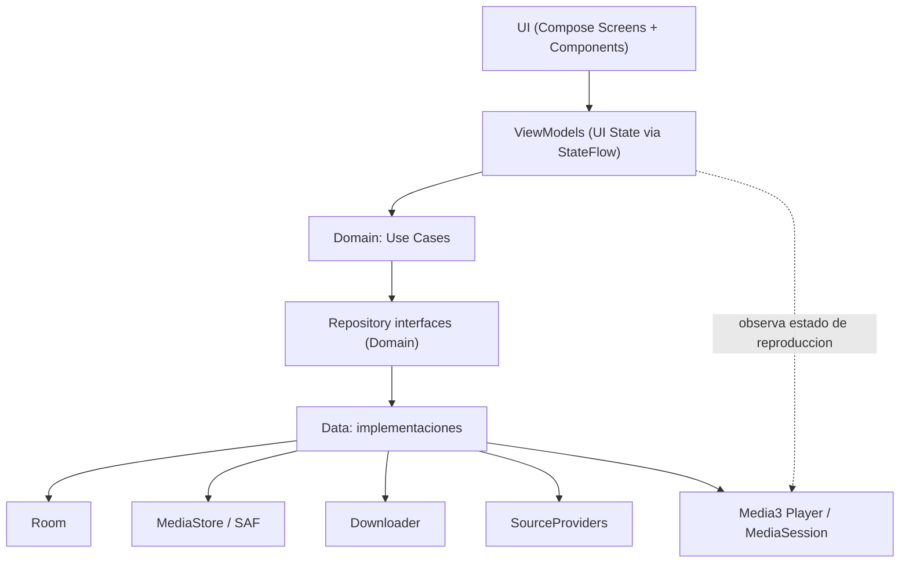
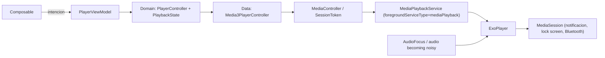
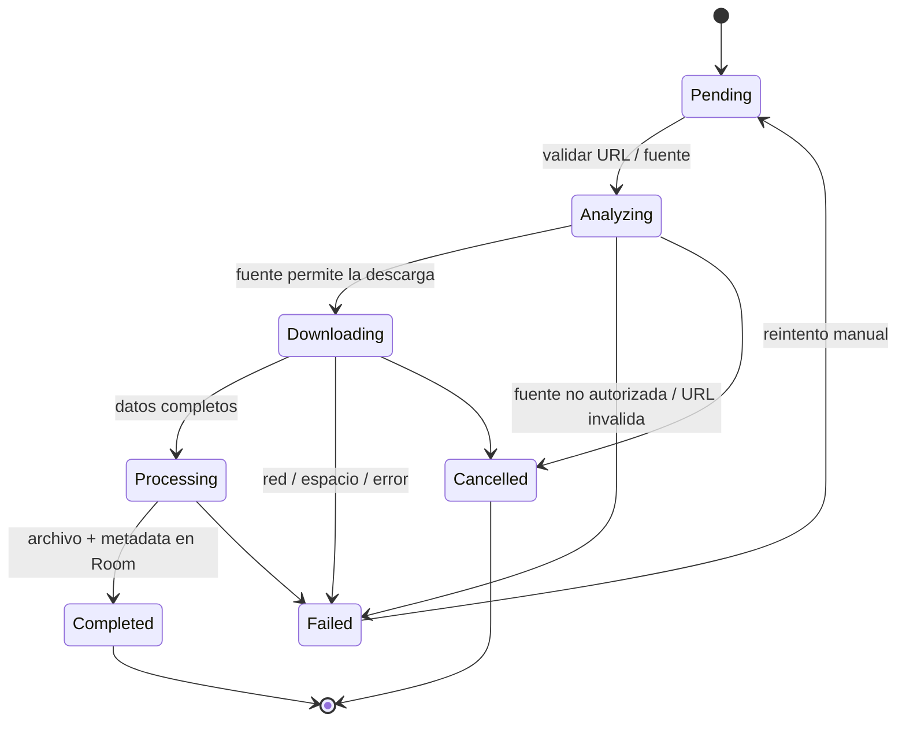

# ARCHITECTURE.md

# MI MÚSICA

Documento técnico de arquitectura.

Este documento debe mantenerse actualizado durante el desarrollo.

---

# 1. OBJETIVO

Definir la arquitectura técnica de la aplicación Android Mi Música.

La arquitectura debe permitir:

- mantenimiento;
- escalabilidad;
- testing;
- separación de responsabilidades;
- bajo acoplamiento;
- evolución independiente de componentes.

---

# 2. STACK

## Lenguaje

Kotlin

## UI

Jetpack Compose

## Design System

Material 3

## Persistencia

Room

## Reproducción

Android Media3

## Concurrencia

Kotlin Coroutines

## Streams reactivos

Kotlin Flow

## Background tasks

WorkManager cuando corresponda.

## Storage

MediaStore / APIs modernas de almacenamiento Android.

## 2.1 Justificación de cada dependencia (Fase 1)

- **Jetpack Compose + Material 3**: sistema de UI declarativo oficial de Android; render, theming (dynamic color) y estados (loading/empty/error) reutilizables sin bibliotecas de terceros.
- **Navigation Compose**: navegación declarativa integrada con Compose; evita reinventar back stack y argumentos.
- **Room (androidx.room3, ver §22.7)**: persistencia de metadata (biblioteca, descargas, playlists) con Flow nativo; sobre SQLite directo ofrece comprobación de tipos en compilación y migraciones gestionadas.
- **Media3 (ExoPlayer + MediaSessionService)**: reemplazo único oficial de EXO/SimpleExoPlayer y compatibilidad integrada con MediaSession, notificación multimedia, audio focus y Bluetooth.
- **Coroutines + Flow**: modelo de concurrencia oficial de Kotlin; WorkManager cuando aplique para descargas diferidas/seguras tras reinicio (decisión fina en FASE 7).
- **KSP**: procesamiento anotaciones Room (opcional, lo que Room requiere por defecto).
- **MediaStore/SAF**: sin `WRITE_EXTERNAL_STORAGE`; escritura de audio con permisos mínimos (API 30+) y selección de archivos con SAF.
- **JUnit + Room tests en JVM (sin Robolectric) + Compose UI Test + androidTest**: stack oficial; ver §22.7.

No se necesita: Retrofit (no servicio REST definido aún), Hilt (DI manual en primer momento), Coil solo si se determina como necesario para carátulas (decisión Fase 2, con carga artesanal por URI local en la mayoría de casos).

---

# 3. ARQUITECTURA GENERAL

La arquitectura sigue Clean Architecture en capas (monomodulo con separacion por paquetes en Fase 3; considerar modulos Gradle solo si el tamano lo justifica):



Reglas de dependencia:

- Presentation solo conoce interfaces de Domain (nunca Room, MediaStore, Media3 ni clientes HTTP directamente).
- Domain no depende de Android salvo lo minimo imprescindible (no de Compose ni de Room).
- Data implementa las interfaces de Domain; evita dependencias circulares y duplicacion de logica.
- Comunicacion reactiva con Flow/StateFlow; corrutinas para todo trabajo bloqueante.

## 3.1 Flujo de reproduccion en segundo plano



Responsabilidades:

- `PlayerController` y los modelos de playback viven en Domain; Presentation no conoce Media3.
- `Media3PlayerController` conecta la UI con la sesion usando `MediaController`, expone estado mediante `StateFlow` y propaga `CancellationException`.
- `MediaPlaybackService` es dueño del `ExoPlayer` y `MediaSession`; se declara como foreground service de tipo `mediaPlayback`.
- ExoPlayer gestiona el foco de audio y `setHandleAudioBecomingNoisy(true)` pausa al desconectar auriculares.
- La cola, el indice, la posicion, `playWhenReady`, el modo de repeticion, el estado shuffle y su orden completo se guardan como datos serializables en preferencias privadas, nunca como objetos Media3. El codec lee snapshots v1 y asigna modos predeterminados a los campos que no existian.
- El acceso a canciones se realiza mediante las URI persistidas por SAF. Si una URI ya no es legible, el error de Media3 se refleja en el estado de playback; no se elimina el registro de Room.
- La validacion fisica de notificacion, lock screen, foco, auriculares, modos de reproducción y restauracion de FASE 9 fue confirmada por el usuario en teléfono Android 14.

## 3.2 Ciclo de vida de una descarga



La descarga se ejecuta fuera del hilo principal; cada estado se persiste para sobrevivir a la muerte del proceso (reanudar desde el ultimo estado conocido).

---

# 4. PRESENTATION

Responsabilidades:

- UI.
- navegación.
- estado visual.
- interacción del usuario.

Componentes:

- Composables.
- Screens.
- ViewModels.
- UI State.
- `PlayerViewModel` transmite el estado de `PlayerController` a `PlayerScreen` y `MiniPlayer`.

La Presentation NO debe:

- acceder directamente a Room;
- ejecutar lógica de negocio compleja;
- controlar directamente detalles de descarga;
- controlar directamente Media3.

---

# 5. DOMAIN

Contiene lógica de negocio independiente de Android cuando sea posible.

Componentes:

- Models.
- Use Cases.
- Repository interfaces.

Ejemplos:

```text
AnalyzeSourceUseCase
DownloadSongUseCase
DeleteSongUseCase
GetLibraryUseCase
SearchSongsUseCase
PlaySongUseCase
```

Los nombres definitivos deben ajustarse al código real.

---

# 6. DATA

Responsable de:

- Room.
- MediaStore.
- descarga.
- metadata.
- fuentes externas.
- reproducción cuando corresponda.

Componentes previstos:

```text
database/
repository/
downloader/
media/
storage/
source/
metadata/
player/
```

`data/player` contiene el controlador Media3, el servicio de sesion y el codec/almacenamiento de la instantanea serializable de reproduccion.

---

# 7. REPOSITORIES

Los repositories abstraen las fuentes de datos.

Ejemplo:

```text
SongRepository
DownloadRepository
SourceRepository
```

Presentation y Domain no deben depender directamente de implementaciones concretas.

---

# 8. DATABASE

Room.

Estructura prevista:

```text
database/
├── AppDatabase
├── SongDao
└── SongEntity
```

Room almacena metadata.

Los archivos de audio se almacenan fuera de SQLite.

## 8.1 Playlists (FASE 10)

- `PlaylistEntity` y `PlaylistSongEntity` implementan la relación m:n entre playlists y `SongEntity`; el orden pertenece a cada playlist.
- `playlist_songs` usa `(playlistId, songUri)` como clave primaria. Las filas se leen por `position` y luego `songUri`, lo que da un orden estable. La reordenación valida que reciba exactamente las URIs actuales y actualiza posiciones dentro de una transacción.
- Las dos claves foráneas usan `ON DELETE CASCADE` solo para filas de `playlist_songs`: borrar una playlist borra sus membresías; borrar una canción de Room la quita de todas las playlists. Ninguna operación de playlist borra archivos físicos.
- La migración v3→v4 crea las tablas e índices de las relaciones sin modificar filas existentes de canciones. No se usa fallback destructivo.
- El nombre se recorta y se rechaza si queda vacío; se permiten nombres duplicados. El ID autogenerado preserva identidad aunque se renombre.
- `PlaylistRepository` expone listas y detalles como Flow. Presentation transforma errores en estado visible y solicita reproducción al `PlayerViewModel` reutilizado; no controla Media3 ni accede a Room.

---

# 9. STORAGE

La aplicación utilizará APIs modernas de Android.

Preferencia:

MediaStore cuando corresponda.

Los registros de Room deben guardar referencias al archivo mediante URI cuando sea apropiado.

---

# 10. DESCARGAS

La descarga debe estar desacoplada de la UI.

Flujo conceptual:

```text
UI
 ↓
ViewModel
 ↓
UseCase
 ↓
DownloadRepository
 ↓
Downloader
 ↓
Storage
 ↓
Room
```

Estados:

```text
Pending
Analyzing
Downloading
Processing
Completed
Failed
Cancelled
```

---

# 11. FUENTES

Las fuentes deben abstraerse mediante interfaces.

Conceptualmente:

```text
SourceProvider
      │
      ├── Provider A
      ├── Provider B
      └── Provider C
```

Esto permite cambiar o agregar fuentes sin modificar toda la aplicación.

Las fuentes deben cumplir las restricciones legales y técnicas aplicables.

---

# 12. AUDIO

El sistema debe distinguir:

```text
Fuente
   │
   ├── formato
   ├── bitrate
   └── duración
          │
          ▼
Procesamiento
          │
          ▼
Archivo final
```

No asumir que un bitrate mayor implica mejor calidad.

## 12.1 Identificación de formato y calidad (sin inflar la calidad real)

- Formato fuente: detectado desde los metadatos reales del archivo/flujo (`MediaExtractor` / `MediaFormat`, o APIs de Media3 para flujos) — nunca deducido de la URL ni de suposiciones del proveedor.
- Bitrate fuente: leído del stream real cuando está disponible; si no, se marca `unknown` en Room y en la UI. Prohibido mostrar un número que la fuente no entregó.
- Formato final: igual al de la fuente cuando el dispositivo lo reproduce sin transcódigo (copia directa del stream / remux). Conversión solo por compatibilidad o petición explícita del usuario, y documentada con el bitrate real resultante.
- Regla anti-inflado: la app muestra la calidad REAL de la fuente. Nunca "320 kbps" heredado de etiquetas falsas ni conversión a bitrate alto como marketing.

---

# 13. REPRODUCTOR

Media3 será responsable de la reproducción.

Arquitectura conceptual:

```text
UI
 ↓
PlayerViewModel
 ↓
PlayerController
 ↓
Media3
 ↓
MediaSession
```

El reproductor debe poder continuar funcionando aunque la UI sea destruida.

---

# 14. BACKGROUND PLAYBACK

La reproducción en segundo plano debe estar desacoplada de Activity/Composable.

Utilizar las APIs modernas recomendadas por Android.

Componentes previstos:

- MediaSession.
- Player.
- servicio de reproducción cuando sea necesario.
- notification.

---

# 15. NAVEGACIÓN

Navegación prevista (Fase 1, ver DESIGN.md):

```text
App
│
├── Home
├── Library
├── Playlists (nuevo: creación/edición de listas)
├── Downloads
└── Settings
```

Player puede funcionar como pantalla independiente y/o bottom sheet según el diseño final.

---

# 16. UI/UX

La arquitectura visual debe definirse mediante UI/UX Pro Max.

Componentes reutilizables previstos:

```text
components/
├── SongCard
├── MiniPlayer
├── DownloadProgress
├── EmptyState
├── ErrorState
├── LoadingState
└── ...
```

No crear duplicados de componentes.

---

# 17. MODELOS

Modelo principal:

```text
Song
```

Información prevista:

```text
id
title
artist
album
duration
fileUri
fileSize
mimeType
bitrate
artworkUri
sourceUrl
downloadedAt
lastPlayedAt
```

Los campos definitivos pueden cambiar durante la implementación.

---

# 18. DEPENDENCY INJECTION

**Decisión (Fase 1): DI manual** (una `AppContainer` / Application-scoped container que construye y expone dependencias) mientras el proyecto sea monomódulo y pequeño.

Ventajas: sin dependencias extra, sin procesamiento de anotaciones, control explícito y fácil testing mediante construcción manual de `Fake` en tests.

Reglas de evolución:
- No usar acceso estático global ni singleton informal; pasar dependencias explícitamente (constructor).
- Si se crea un segundo módulo Gradle o el número de ViewModels crece de forma notable, evaluar migración a Hilt (documentando decisión anterior, nueva y motivo en este archivo).

---

# 19. TESTING

Testing por capas:

```text
Domain
 ↓
Unit Tests

Data
 ↓
Repository / Database Tests

Presentation
 ↓
ViewModel Tests

UI
 ↓
UI Tests
```

---

# 20. SEGURIDAD

Principios:

- validar entrada;
- sanitizar archivos;
- evitar path traversal;
- evitar command injection;
- no ejecutar comandos arbitrarios;
- no almacenar secretos;
- minimizar permisos;
- minimizar datos externos.

---

# 21. PERFORMANCE

Prioridades:

- UI fluida;
- evitar trabajo en Main Thread;
- controlar memoria;
- controlar imágenes;
- evitar consultas innecesarias;
- evitar recrear reproductores;
- controlar descargas concurrentes.

---

# 22. DECISIONES DE BUILDS Y STACK (RESUELTAS EN FASE 1)

Decisiones tomadas a partir de la FASE 0 y la documentación oficial de Android (revisada el 2026-10-27, AGP 9.4.0 — septiembre 2026):

| Elemento | Decisión | Motivo |
|---|---|---|
| AGP | 9.4.x | Última versión estable con compatibilidad hasta API 37 (coincide con la plataforma instalada). |
| Gradle | Wrapper 9.6.0+ | Requerido por AGP 9.4; no hay instalación global, se usará `gradlew`. |
| JDK para ejecutar Gradle | JBR de Android Studio (OpenJDK 25.0.3) | AGP requiere mínimo JDK 17; JBR 25 cumple. No se necesita desinstalar ni cambiar Java. Si Gradle emitiera advertencias de toolchain, se fijará Java toolchain 17 explícito. |
| Java toolchain / target | 17 (explícito) | Estándar recomendado por la documentación; evita divergencia entre máquinas. |
| compileSdk | 37 | Única plataforma instalada y máxima soportada por AGP 9.4. |
| targetSdk | 36 (propuesta) | Conservador: 36 evita exposición temprana a cambios de comportamiento del SDK más reciente; se revisará en Fase 3 según el comportamiento en el AVD API 37. |
| minSdk | 26 (propuesta) | Da acceso a MediaSession/APIs de audio modernas y reduce la complejidad de permisos legacy; propuesta a validar en Fase 3. |
| Kotlin | Versión recomendada por AGP 9.4 (línea 2.x), fijada en Fase 3 | No inventar número: se fijará al crear el proyecto con la versión que el AGP y el catálogo oficial indiquen. |
| Dependency Injection | DI manual en primer momento; Hilt opcional si el proyecto crece | El proyecto es monomódulo inicial; Hilt añade procesamiento de anotaciones y complejidad de build. Koin descartado por no ser el estándar de Google. Se decidirá de forma definitiva en Fase 3 antes del primer ViewModel. |

# 22.5 VERSIONES VERIFICADAS EN CONSTRUCCIÓN REAL (FASE 3)

Compilación verificada el 2026-10-27 con `gradlew.bat assembleDebug` → BUILD SUCCESSFUL.

| Elemento | Valor real | Fuente de la decisión |
|---|---|---|
| Gradle | 9.6.0 (wrapper: gradle-9.6.0-bin.zip) | Compat oficial AGP 9.4: mínimo Gradle 9.6.0. |
| Gradle interno (reportado por gradlew --version) | Kotlin 2.3.21 / Groovy 4.0.32 | Solo afecta scripts Gradle, no el proyecto. |
| JVM ejecutando Gradle | JBR OpenJDK 25.0.3 (`C:\Program Files\Android\Android Studio\jbr`) | ≥ mínimo JDK 17 de AGP; no cambió JDK. |
| AGP | com.android.application 9.4.0 (version catalog) | Documentación AGP 9.4.0 (sept 2026). |
| Kotlin | Built-in Kotlin de AGP 9 (KGP interno, sin `kotlin-android` aplicado) | Doc "Migrate to built-in Kotlin". |
| Compose Compiler | org.jetbrains.kotlin.plugin.compose 2.2.10 | Alineado con KGP mínimo de AGP 9 (doc AGP 9.0 release notes). |
| Compose BOM | 2026.09.00 | Doc "Setup Compose dependencies and compiler" (recomendación vigente). |
| compileSdk | 37 | Máxima soportada por AGP 9.4 y única plataforma instalada. |
| targetSdk | 36 (explícito) | Conservador; no heredado de compileSdk (propietario de AGP 9: default = compileSdk si no se fija). |
| minSdk | 26 (propuesto, pendiente validación) | Decisión FASE 1; se valida en una fase posterior. |
| Java target del proyecto | 17 (`compileOptions.source/targetCompatibility`) | Recomendación oficial; negocio distinto del JDK que ejecuta Gradle. |
| Repositorio de los módulos | proyecto monomódulo `:app`, namespace `com.example.mimusica` | Estructura estándar. |

ADVERTENCIA del entorno: el emulador no funciona por falta de aceleración/hipervisor — queda pendiente para las fases que necesitan pruebas en pantalla; alternativa: dispositivo físico.

## 22.6 Compatibilidad resumida (verificada)

```text
JBR 25.0.3 (instalado)  ✓ mayor que el mínimo JDK 17 requerido por AGP 9.4
Gradle 9.6.x            ✓ requerido por AGP 9.4 (se usará wrapper, no instalación global)
AGP 9.4                 ✓ compatible con compileSdk 37 (máxima soportada)
java toolchain = 17     ✓ límite de lenguaje/API de Java para fuentes del proyecto
```

No se requiere desinstalar ni modificar ninguna instalación Java existente.

---

# 22.7 PERSISTENCIA LOCAL — Room 3 (FASE 4, verificada 2026-10-27)

- Dependencias: `androidx.room3:room3-runtime 3.0.3` + `room3-compiler` vía KSP `2.2.10-2.0.2` (emparejado con el Kotlin integrado del AGP 9.4) + `androidx.sqlite:sqlite-bundled 2.7.1`. Room Gradle plugin `androidx.room3` para exportar esquema a `app/schemas` (v1).
- Driver: `BundledSQLiteDriver` en producción y en tests (SQLite compilada, versión consistente; recomendación oficial de Room KMP). `AppDatabase.build(path)` reutilizable por tests.
- Identidad/duplicados: PRIMARY KEY = URI del contenido (`songs.uri`), `OnConflictStrategy.IGNORE` al insertar; re-importar el mismo archivo NO duplica filas.
- Metadatos opcionales (`mimeType`, `sizeBytes`, `bitrateBps`) nullable: null = desconocido; nunca se inventa calidad de audio (AGENTS §8). No hay columnas de "calidad" subjetiva.
- Búsqueda: `LIKE '%'||:q||'%'` sobre `title`/`artist` (índices creados); observación `Flow<List<SongEntity>>` ordenada por título COLLATE NOCASE.
- Arquitectura: Presentation solo ve `domain/repository/SongRepository` (interfaz pura); `SongRepositoryImpl` (Data) traduce Entity<->Song con mapeo explícito. DAO/solo dentro de Data/di.
- DI manual: `AppContainer` creado por `MiMusicaApplication`; singleton de DB por proceso.
- Tests en JVM sin Robolectric ni emulador: la misma build de producción (`Room.databaseBuilder(name) + BundledSQLiteDriver`) sobre archivo temporal de `TemporaryFolder`. Se necesita `testRuntimeOnly(sqlite-bundled-jvm)` porque la variante Android del driver carga una `.so` nativa de Android que la JVM del test no contiene.
- Ajustes de build empleados (mensajes oficiales de AGP): `android.disallowKotlinSourceSets=false` (KSP añade fuentes generadas; error "Using kotlin.sourceSets DSL is not allowed with built-in Kotlin"), y la extensión Room se configura con `configure<androidx.room3.gradle.RoomExtension>` porque el accesor `room{}` del plugin no se genera con built-in Kotlin.
- Warnings aceptados documentados: `System::loadLibrary` restringido en JDK 25 (requerirá `--enable-native-access` en JDKs futuros); "Kotlin no soporta target 25, degrada a 24" al compilar las pruebas unitarias.

---

# 22.8 IMPORTACIÓN DE AUDIO LOCAL — SAF + Room (FASE 5, verificada 2026-10-27)

- **Selección**: `ActivityResultContracts.OpenMultipleDocuments(arrayOf("audio/*"))` vía SAF. Ningún permiso de almacenamiento amplio (mínimo privilegio). Cancelar (uris vacías) es un no-op.
- **Permisos persistibles**: `takePersistableUriPermission(uri, FLAG_GRANT_READ)` se invoca en el callback del launcher (actividad todavía activa). `SecurityException` ignorada por proveedores sin persistencia (documentación oficial: el permiso es una petición, no un derecho). Límite del sistema ~128 (API<31)/512 (31+).
- **Identidad/deduplicación**: PRIMARY KEY Room = URI del contenido; `addSongs` devuelve el número de filas NUEVAS (rowid>=0) para el informe (añadidas vs ya existentes).
- **Validación de formato**: el MIME REAL de la pista se lee con `MediaExtractor` (no la extensión ni el mime del documento) y se clasifica con `AudioFormat` (MP3/M4A/AAC/FLAC/WAV/OGG/OPUS). Sin pista de audio reconocible → `UNSUPPORTED_FORMAT` y el resto del lote continúa.
- **Metadatos**: `MediaMetadataRetriever` (título/artista/álbum/duración/bitrate/portada) + extractor (media mime, sampleRate, canales). null = desconocido. Fallback título: retriever → displayName → `"Audio sin título"` (constante documentada).
- **Errores de archivo `PreparedAudio(failure)` en tramos**: version manejo "per file" (SecurityException/FileNotFound → INACCESSIBLE; IO/IllegalState → UNREADABLE; guardia de tamaño 512 MB consultada ANTES de leer → TOO_LARGE); el app nunca cierra por un archivo defectuoso.
- **Artwork**: copia única atómica a `filesDir/artwork/{md5(uri)}-v{n}.jpg|png|img` (`ArtworkStore`); no depende del permiso SAF; no decodifica Bitmap en importación; UI muestra placeholder (patrón del Design System) mientras tanto.
- **Concurrencia**: lecturas en `Dispatchers.IO`; `LibraryViewModel` con `StateFlow` (`ImportState.Idle/Running(current,total)/Done(report)/Failed`) y `Mutex` para evitar importaciones concurrentes.
- **Room v2**: `MIGRATION_1_2` con `suspend fun migrate(connection: SQLiteConnection)` y `connection.prepare(sql).use{ it.step() }` (API verificada en androidx.sqlite 2.7.1 — NO existe `execSQL` en el KMP `SQLiteConnection`). Esquemas v1/v2 exportados a `app/schemas`.
- **Tests JVM**: 19 (ver PLAN FASE 5). Los siguientes quedan pendientes por falta de entorno Android: picker UI, permisos persistibles con proveedores reales, lectura de archivos reales, test de migración 1→2 con `room3-testing`.

---

# 22.9 FUENTES DE AUDIO — MATRIZ DE CAPACIDADES (FASE 6: análisis, sin implementación)

Objetivo: decidir QUÉ fuentes pueden integrarse y con qué operaciones autorizadas, ANTES de diseñar descargas (FASE 7). Regla §22.2: solo se integrará una fuente si el proveedor autoriza oficialmente la operación; no se implementará ninguna vía no declarada.

Verificación: enlaces consultados el 2026-10-27 salvo indicación "por re-verificar".

## Matriz

| Fuente / tipo | API o mecanismo oficial | Operaciones autorizadas | Restricciones relevantes | Autenticación | Formatos/metadata disponible | Enlace oficial | Viabilidad | Incertidumbres |
|---|---|---|---|---|---|---|---|---|
| **Archivos locales (SAF)** — base del proyecto | Storage Access Framework: `OpenMultipleDocuments`, `takePersistableUriPermission` | Leer metadatos; copiar bytes (incluida portada) hacia el app a petición del usuario | Límite ~128/512 permisos persistibles; algunos proveedores no conceden persistencia | Ninguna (grant por URI, seguro) | Título/artista/álbum/duración/bitrate/portada/samplerate/canales vía MediaExtractor+MediaMetadataRetriever | developer.android.com/training/data-storage; developer.android.com/kotlin/multiplatform/room | ✅ YA IMPLEMENTADO (FASE 5) | Comportamiento por proveedor de documentos varía |
| Medios locales indexados (MediaStore) | `MediaStore.Audio.Media.CONTENT_URI` (query con ContentResolver) | Consultar biblioteca del dispositivo, metadatos y URIs | Solo lectura de metadatos existentes; no duplicar datos sensibles | Ninguna (audio es público vía MediaStore en API 29+) | Título/artista/álbum/duración/mime/tamaño; portada vía embedded | developer.android.com/training/data-storage/shared/media (por confirmar propuesta exacta en pruebas de dispositivo) | ✅ Alta (complementa SAF; buena UX sin picker por archivo) | Requiere prueba en dispositivo real |
| **Internet Archive** | API oficial: Metadata (developer portal) + archivos con URLs directas por ítem | Buscar ítems/metadata; descargar archivos Public Domain / CC conforme a licencia por archivo | Las licencias varían por archivo: hay que verificar el campo `license` por fichero; ciertos items están marcados "do not use" | Anónima para lectura (S3 keys solo para subir) | mp3/ogg/flac, covers y tags en la metadata del ítem (developer portal: "Item"/"Metadata") | archive.org/developers/index.html (portal leído 2026-10-27) | ✅ Alta (dominio público/CC; gratuita) | Rate limits no documentados por leer; endpoint de búsqueda (search API) por verificar |
| **Jamendo** | API REST oficial v3.0 con `client_id` | Búsqueda/metadata; **descarga vía `/v3.0/tracks/file`** (redirect) SOLO si `audiodownload_allowed=true` por pista (404 si false) | Uso no-comercial: 35.000 req/mes; atribución requerida (API TOU); términos a aceptar en devportal | client_id (app) / OAuth2 solo para métodos de usuario | mp31(96 kbps)/mp32(VBR)/ogg/flac + metadata (artista, álbum, cover, licencia) | developer.jamendo.com/v3.0/docs; developer.jamendo.com/v3.0/tracks/file (leídos 2026-10-27) | ✅ Alta (descarga expresamente autorizada con flag) | Cómo mostrar cada licencia CC en la app; política de atribución (texto visible) |
| **Wikimedia Commons** | MediaWiki API (`commons.wikimedia.org/w/api.php`, autodocumentada) | Consultar archivos de audio de libre acceso (CC/PD) y su metadata/licencia | Archivos con tag "do not use" no se indexarán ni usarán; atribución necesaria | Ninguna para lectura | MIME real vía API de fichero, tamaño, licencia, artistas | commons.wikimedia.org/wiki/Commons:API (leído 2026-10-27) | ⚠️ Media (catálogo disperso; descubrimiento musical limitado) | Endpoint de búsqueda de audio; filtro de licencias |
| **SoundCloud** | API oficial v2 (client_id; OAuth para acciones de usuario) | Búsqueda/metadata; reproducción con player/SDK oficial. **Descarga: PROHIBIDA** por API TOU §05 ("must not include file-save functionality", sin offline) y §10 (no stream ripping) | Caching solo de sesión; sin descargas aunque el uploader active el botón de "download"; sin acceso al contenido Go/privado | client_id; OAuth2 para acciones de usuario | Metadata rica (título/artista/cover); URLs de stream protegidas de captura | developers.soundcloud.com/docs/api/terms-of-use (leído 2026-10-27) | ❌ Solo streaming; NO como fuente de descargas | Endpoint de búsqueda estable en API v2; reproducción en streaming en FASE 10 |
| **YouTube / YouTube Music** | IFrame/Embedded Player API; YouTube Data API (solo metadata) | Reproducción via player oficial; metadata y búsqueda con API | Restricción de descarga ** declarada por los TOS de YouTube, pero PENDIENTE de verificación directa** (leer el texto oficial antes de la FASE 7); stream ripping prohibido | OAuth2/clave Data API del usuario conectado | Metadata, thumbnail, títulos vía Data API v3; audio SIN vía legítima de descarga | youtube.com/static?template=terms; developers.google.com/youtube/terms (por re-verificar al redactar FASE 7) | ❌ NO integrable como descarga (viola la regla §22.2) | Sin vía oficial prevista por Google |
| **Spotify** | Web API (metadata/playlists) + Android playback SDK | Metadata y búsquedas; reproducción vía Spotify App Remote (si el usuario tiene cuenta) | Restricción de descarga/offline declarada por las condiciones de Spotify, PENDIENTE de verificación directa (leer Developer Policy antes de la FASE 7); caching solo técnico temporal | OAuth2 (token de usuario) | Metadata (título/artista/album/duración); previews 30 s OGG | developer.spotify.com/documentation (por re-verificar en la fase correspondiente) | ❌ NO descargable; solo metadata; posible reproducción remota en FASE 10 si aporta valor |
| APIs de dominio público (Musopen, FMA, etc.) | Verificación pendiente por proveedor | Desconocida hasta verificar | — | — | — | — | ⬜ Por verificar | Estado del servicio (FMA se relanzó tras cerrar), API/cuotas, formatos |

Ninguna fuente implica: bypass de DRM, evasión de autenticación, paywall o servicios no autorizados (AGENTS §12; regla §22.2 del proyecto).

## Arquitectura futura propuesta (NO implementar en esta fase)

Diseño compatible con Presentation→Domain→Data y sin acoplarse a la UI ni a Room:

```text
Presentation (Ajustes/Descargas/Buscar)
        ↓ usa interfaces
Domain:
  MusicSource          ← contrato por fuente (interface en com.example.mimusica.domain.source)
    ├── search(query): List<TrackReference>
    ├── metadata(ref): SourceMetadata      (cc/licencia,duration, cover, formato)
    ├── capabilities(): SourceCapabilities { canSearch, canStream, canDownload, licensing… }
    └── download(ref): Stream<File/DaoType>  SOLO si capabilities.canDownload
  SourcePipeline       ← orquestación neutra: DownloadRequest → progress → Result
Data:
  impl/… (JamendoSource, ArchiveOrgSource, MediaStoreSource…)
  todo lo específico vive en Data; Domain solo contratos y modelos
  Room persiste TrackReference + resultado de descarga vía SongRepository existente
DI: AppContainer registra sources activos; la UI no sabe cuál está detrás.
```

Reglas del diseño: si una fuente no puede descargar, `capabilities.canDownload=false` y la UI no ofrece la acción (nada de botones de mentira); cada fuente declara su licencia/atribución; las fuentes se registran o se desactivan por completo en el `AppContainer`, sin tocar Room ni la UI (plug-in por registro de DI).

## Próximas verificaciones necesarias (antes de FASE 7)

1. Términos oficiales exactos de YouTube/Spotify (requieren revisión en detalle al redactar FASE 7).
2. Rate limits y ToU completos de Jamendo/IA con un client_id registrado en devportal.
3. Probar integralmente por-device MediaStore en dispositivo real.

---

# 22.10 PAUSA DE DESCARGAS Y ARQUITECTURAS PREVISTAS (2026-10-28)

## Motivo de la pausa de FASE 7

La FASE 7 queda PAUSADA tras completar la entrega 7.0 (contratos de dominio + pruebas, sin red ni Room). Se retomará más adelante tras evaluar, con calma y fuera de presión de entrega:

1. **Motor HTTP**: HttpURLConnection (cero dependencias, ya incluido en el JDK/Android) vs OkHttp (dependencia nueva: justificar impacto APK, compatibilidad con AGP 9/Kotlin integrado y mantenimiento — regla de dependencias).
2. **Ejecución en segundo plano**: WorkManager (descargas diferidas que sobreviven a reinicios; dependencia nueva) vs User-Initiated Data Transfer (APIs oficiales para transferencias iniciadas por el usuario) vs foreground service. NINGUNA dependencia añadida: estas son decisiones pendientes, no hechos comprobados.
3. **NewPipe Extractor y extractores similares**: su uso exige primero evaluar licencia, condiciones de uso y la legalidad de cada proveedor objetivo. Regla fija de AGENTS §12/§22.2: sin bypass de DRM/autenticación/paywall; si un extractor solo funciona eludiendo controles del proveedor, la fuente se descarta.
4. **Condiciones legales vigentes** de cada proveedor candidato (re-verificación obligatoria al retomar: la matriz §22.9 tiene fecha de lectura).

## Lo construido y su compatibilidad futura

- `domain/source/*` y `domain/download/*` son Kotlin puro, sin Android, sin Room y sin proveedores: la pausa NO los condiciona. El motor (7.2) y la persistencia de descargas (7.3) se montarán ENCIMA de estos contratos.
- Integración con la biblioteca por el mismo camino que la importación local: `DownloadRequest` → archivo local validado reutilizando el lector real de FASE 5 (MediaExtractor) → `SongRepository.addSongs` (URI = fichero local; dedup por URI). Una canción descargada en el futuro será, para la biblioteca, indistinguible de una importada.

## Arquitectura del reproductor (FASE 9)

```text
UI → PlayerViewModel → PlayerController/PlaybackManager → Media3 (candidato, pendiente de evaluación) → archivo local
```

- La UI transmite estado y acciones; el control del reproductor queda en Data/service; Domain define el playback contract puro (cola incluida).
- La cola de reproducción es independiente de `DownloadQueue` (7.0); solo comparten estilo FIFO/estados.
- Media3 `MediaSessionService` implementa reproducción en segundo plano, notificación, lock screen y controles externos, según §3.1.
- Repeat/Shuffle se delegan a Media3; Domain expone modos propios y el snapshot serializable conserva modo, shuffle order y estado de cola.

## Arquitectura de playlists (FASE 10)

```text
Playlist ──< PlaylistSong >── Song   (m:n; orden por índice propio de cada lista)
```

- Tablas Room `playlists` y `playlist_songs` añadidas en la migración v3→v4; `position` define el orden propio de cada playlist.
- `playlist_songs` tiene PK `(playlistId, songUri)` y FKs con `ON DELETE CASCADE` desde la playlist y `SongEntity`. Cascade elimina exclusivamente la membresía en la relación: borrar una canción de Room la quita de las playlists, pero nunca borra el archivo físico.
- La reordenación verifica transaccionalmente que la entrada sea una permutación exacta de las URIs actuales. Nombres se recortan y no pueden quedar vacíos; nombres duplicados se permiten.
- `PlaylistRepository` expone listas/detalle mediante Flow; reproducir desde la lista o un elemento reutiliza el `PlayerViewModel` y construye la cola desde el orden persistido.

## Arquitectura prevista de ajustes (FASE 11)

- Preferencias simples con DataStore candidato (dependencia nueva pendiente de aprobación; alternativa: hasta entonces, sin settings, nada).
- Los ajustes afectados a FASE 8–9 (tema, orden, comportamiento de borrar, reanudación) leerán esas preferencias; ninguna opción decorativa sin implementación real.

## Decisiones pendientes (bloqueantes de fases concretas)

- WorkManager/UIDT: motores del pausado sistema de descargas (Fase 7).
- OkHttp/HttpURLConnection: del motor de descarga pausado (Fase 7).
- DataStore: para Fase 11 (alternativa: SharedPreferences/documents comunes ya disponibles, menos idiomática).
- Comportamiento de eliminación de canción (quitar registro vs borrado físico confirmado): se consolidará en FASE 8 §8.3.
- Almacenamiento final de descargas (app-privado vs MediaStore): Fase 7 al retomarla; FASE 8 no depende de esto.
- minSdk/dynamic color y demás detalles de apariencia: al definir Fase 11 sobre lo ya implementado.

---

# 22.11 FASE 8 — MODELO DE BIBLIOTECA (decisiones autorizadas, 2026-10-28)

Decisión previa al código. Completa los contratos ya existentes (Room v2, `Song`, `SongRepository`, importación SAF de FASE 5) sin tocar la FASE 7 pausada (`domain/source/*`, `domain/download/*`).

## D8.1 Género (real o nada)

- `Song.genre: String?` y `SongEntity.genre: String?` (nullable; `null` = desconocido).
- Fuente ÚNICA: `MediaMetadataRetriever.METADATA_KEY_GENRE` (API oficial, disponible ≥ API 20) durante la importación SAF — el género se extrae del archivo; nunca se infiere del nombre, del artista ni de la URI (AGENTS §8/§19).
- UI: null → etiqueta localizada "Desconocido".

## D8.2 Room v3

- `MIGRATION_1_2` existente se conserva; nueva **`MIGRATION_2_3`** (suspend, `connection.prepare/step`, mismos hechos verificados de `SQLiteConnection` — NO existe `execSQL`):
  - `ALTER TABLE songs ADD COLUMN genre TEXT`.
  - `CREATE INDEX index_songs_album ON songs(album)` y `index_songs_dateAddedMs` — justificados SOLO porque las consultas previstas (dectalle/orden por álbum, recientes) los usan en WHERE/ORDER BY. La PK `uri` ya garantiza el índice por URI.
- Schemas v1/v2/v3 exportados. FASE 10 añadió v4; cualquier migración de descargas futura debe usar la siguiente versión libre cuando se autorice esa fase.

## D8.3 Consultas y repositorio

- Agrupados de artistas/álbumes con SQL (`GROUP BY`/conteo) — sin cargar toda la biblioteca ni hacer N+1 desde UI.
- **Orden (FASE 8.3)**: el orden de la biblioteca completa SIEMPRE en SQL (consultas dedicadas por orden en `SongDao`, desempate estable por `uri`; sin índices nuevos). El orden seleccionado es estado de UI sin persistencia (sin DataStore en FASE 8). En solo los RESULTADOS de búsqueda (subconjunto filtrado, pequeño) se re-ordena en memoria con `SongSort.toComparator()`, replicando EXACTAMENTE el ORDER BY SQL (plegado ASCII = COLLATE NOCASE, tildes sin plegar, nulls al final, desempate uri) — paridad SQL↔comparador asertada en pruebas.
- **Comportamiento REAL del LIKE (decisión 8.2):** la búsqueda incluye título, artista y álbum; `%` y `_` de la consulta del usuario son **TEXTO LITERAL** (escapados con `ESCAPE '\'` en `SongRepositoryImpl.escapeLikePattern`, único punto de la política); la insensibilidad de mayúsculas es la REAL de SQLite (solo ASCII; las tildes NO se pliegan — el folding de acentos, si la UI lo desea, se decide en 8.3 a nivel de consulta del usuario, nunca en la BD). Búsqueda vacía (tras trim) = biblioteca completa vía consulta dedicada. Orden secundario SIEMPRE por `uri` para resultados equivalentes estables.
- **Orden en presencia de NULL**: en los listados de un álbum/artista, SQLite ordena `NULL < texto` (comportamiento real, asertado). En `ArtistSummary`/`AlbumSummary` el bucket desconocido se ordena AL FINAL con `CASE WHEN`.
- `ArtistSummary`/`AlbumSummary` en Domain (Kotlin puro); el valor NULL (desconocido) se modela explícitamente, sin sustituirlo por cadenas mágicas en la base de datos.
- Eliminación: `deleteSong(uri)` YA existe (borra el registro Room); el borrado físico del archivo NO se implementa en FASE 8 (requeriría ContentResolver.delete con confirmación — acción separada, futura, con aprobación).

## D8.4 Compromisos con FASE 9/10 (sin implementar)

- Reproducción: la UI llamará a un `PlayerController` (interfaz de FASE 9) — en 8.6 queda como callback no operativa claramente marcado; nada de Media3 en el classpath.
- Playlists: `Song`/`.uri` usado como identidad compartida (PK de `songs`) es compatible con la futura tabla de unión `playlist_songs(songUri, ...)`.
- Prueba de migración instrumentada (RoomMigrationTestHelper) sigue pendiente por falta de emulador; la validación JVM re-open con datos previos cubre el caso feliz.

## D8.5 Navegación por artistas/álbumes (FASE 8.4, 2026-10-29)

- **Rutas anidadas**: las vistas de biblioteca viven en un `navigation(...)` con grafo de ruta `library` (start `library/songs`). La bottom bar NO cambió: su destino "library" ahora resuelve al grafo (mismo comportamiento) y la selección se conserva en las rutas hijas vía `hierarchy`. `openGroup()` codea el nombre con `Uri.encode` (espacios, `/`, `&` llegan intactos); para el bucket desconocido la ruta va SIN parámetro — el `null` es un destino normal, no una anomalía.
- **Contrato de detalle**: usa las consultas suspend de 8.2 (`getSongsByArtist`/`getSongsByAlbum`, orden SQL definido) con CARGA ÚNICA al abrir el grupo: el snapshot es suficiente en FASE 8 (sin reproducción ni edición que muten el grupo desde el detalle); la reactividad completa del detalle se reevalúa con el reproductor de FASE 9. Las LISTAS de resúmenes sí son reactivas (DAO Flow, re-emite con cada cambio de `songs`).
- **Null → etiqueta**: el nombre `null` viaja intacto Domain→Presentation; "Artista desconocido"/"Álbum desconocido" existe SOLO en `ui/screens` (regla Summaries.kt). El detalle con datos no válidos no crashea: Loading→Content|Error explícitos.
- **Reutilización**: `SongRow`/`SongList`/`ArtworkThumbnail`/`formatDuration` extraídos de `LibraryScreen` a `components/SongListItems.kt` (un único punto de filas de canción para biblioteca y detalles; FASE 9/10 lo reutilizará).
- **ViewModels con argumento de ruta**: factories por destino en `AppContainer` (`artistDetailViewModelFactory(name)` / `albumDetailViewModelFactory(name)`); DI sigue manual.
- **Pruebas**: 8 casos de `GroupSummariesModel`/`GroupDetailModel` (JVM, scope propio como 8.3, `await` por predicado sin debounce) — reactividad de resúmenes, bucket `null` navegable, nombres especiales, error conservando lista previa / estado Error sin crash, contenido vacío. `kotlinx-coroutines-test` sigue sin aprobarse.

## D8.6 Detalle de canción (FASE 8.5, 2026-10-29)

- **Bottom sheet M3 como destino**: ruta `library/song?uri={uri}` dentro del grafo `library` (parámetro tipo query + nullable: la URI real `content://...` se codea con `Uri.encode` para sobrevivir a `/`, `:`, `%`; ausente → pantalla defiende con NotFound, sin crash). El sheet se cierra con swipe/back → `popBackStack`.
- **Datos REALES únicamente**: `Song` viaja INTACTO Domain→Presentation (contrato existente `getSong(uri)` de 8.2); los `null` del DOMAIN se sustituyen por "Desconocido" SOLO en la UI (`song_detail_unknown`); el bitrate convertido a kbps es matemática exacta del valor medido en importación (MediaExtractor), sin redondeos engañosos; tamaño/frecuencia/muestras con formato determinista (Locale.ROOT, punto decimal). Duración reutiliza `formatDuration` (0 = desconocida).
- **Estados**: Loading / Content / NotFound (canción quitada de la biblioteca o uri desconocida) / Error — nunca crash por datos (AGENTS §12). El archivo YA NO DISPONIBLE pero registrado sigue mostrando sus metadatos; su detección bajo demanda con badge es la FASE 8.7 (sin implementar aquí).
- **Acceso reutilizando componentes**: fila de canción clicable opcional (`SongRow(onSongClick)` — null = no clicable, como la reproducción aún pendiente); activo en biblioteca y en los detalles de artista/álbum (8.4). Sin menú contextual ni eliminación: eso es la 8.6.
- **Sin cambios de esquema ni dependencias**: Room v3 intacta; ningún método nuevo en el repositorio.
- **Pruebas**: 8 casos de `SongDetailModel` + helpers puros (JVM, `runBlocking` directo — el `load()` es suspend, sin Main): carga con nulls intactos, NotFound, uri nula/vacía sin consultar repo, error del repo sin crash, formato exacto de tamaño/bitrate/frecuencia. Sin `kotlinx-coroutines-test` (no autorizada).

## D8.7 Gestión de canciones (FASE 8.6, 2026-10-29)

- **Alcance EXACTO del plan 8.6**: menú contextual por canción con cuatro acciones. «Reproducir» y «Añadir a playlist» son ítems presentes e INOPERANTES (`enabled=false`, callbacks por refuerzo identificados para FASE 9/10) — sin Media3 ni tabla de playlists en el classpath. «Información» reutiliza el detalle de 8.5. «Eliminar de biblioteca» es la única acción de gestión activa; la comprobación del archivo se añade en D8.8.
- **Eliminación = SOLO registro Room** (D8.3 ratificada): llega a `deleteSong(uri)` (contrato 8.2, existente) SOLO tras el `AlertDialog` de confirmación, cuyo texto dice explícitamente «El archivo no se borra del dispositivo»; el borrado físico sigue sin implementarse (acción futura separada con aprobación, ARCHITECTURE D8.3).
- **Concurrencia y errores**: una eliminación a la vez (`LibraryManagerModel.busy`; segunda llamada concurrente se ignora); fallo → `manageError` → banner errorContainer SIN borrar la lista, limpiado por el siguiente éxito (política 8.3/8.4). La SINCRONIZACIÓN lista↔Room es 100 % reactiva con los Flows ya existentes (biblioteca completa, búsqueda, resúmenes de artista/álbum): el modelo no recarga nada.
- **Ubicación del menú**: solo en la biblioteca (`SongList(menuFactory=...)`); los detalles de artista/álbum (8.4) conservan filas simples — la distribución final de gestión se reevalúa en 8.8 (Tabs), sin inventar alcance.
- **Sin cambios de esquema ni dependencias**; pruebas JVM directas de `LibraryManagerModel` (5 casos).

## D8.8 Disponibilidad de archivos (FASE 8.7)

- La comprobación es **bajo demanda por canción** desde el menú de biblioteca; nunca se recorren archivos al iniciar la app. Reutiliza el `ContentResolver` y `AudioMetadataReader.streamFormat`/`MediaExtractor` sobre la URI SAF y sus permisos persistibles existentes, siempre en `Dispatchers.IO`. Abrir el descriptor primero distingue falta de archivo/permiso de un error al analizar el stream.
- Los resultados viven solo en estado de presentación, por URI (no cambian `Song`, Room ni el esquema): disponible, ausente (`FileNotFoundException`), inaccesible (permiso revocado o fallo I/O/proveedor al abrir) y no válido (URI/formato/estructura sin pista de audio admitida, o error I/O al analizarla). Una URI se vuelve a comprobar explícitamente para actualizar el estado.
- El análisis valida el contenedor y las pistas expuestas por `MediaExtractor`; no decodifica el archivo completo, por lo que no promete detectar corrupción posterior dentro del flujo de audio.
- Ningún resultado elimina registros ni archivos. La retirada de un registro continúa siendo una acción manual separada, con la confirmación existente de D8.7; los estados se descartan al salir la URI de la biblioteca.
- Sin permisos, dependencias, migraciones ni cambios a los contratos de `domain/source/*` o `domain/download/*`.

---

# 22.3 DECISIONES PENDIENTES (POST-FASE 1)

- [ ] Confirmar `minSdk` exacto (propuesta: 26) — FASE 3.
- [ ] Confirmar la versión exacta de Kotlin que seleccione el AGP final.
- [ ] Confirmar `targetSdk` definitivo (propuesta: 36).
- [ ] Confirmar fuentes compatibles finales y diseño del Player (pantalla completa vs bottom sheet).
- [ ] Confirmar estrategia definitiva de descarga (HTTP directo vs WorkManager según restricciones reales).
- [ ] Fuentes: documentar las operaciones permitidas en cada proveedor (ver 22.2).

## 22.2 Fuentes y restricciones

No se implementará ningún mecanismo que eluda DRM, autenticación, paywall ni restricciones técnicas de una fuente.

Reglas de diseño para `SourceProvider`:
- Cada proveedor declarado debe documentar qué operaciones permite oficialmente la fuente; no se implementará ninguna operación no autorizada. Si la fuente no declara una vía permitida, la acción no se expondrá en la UI.
- Para YouTube y servicios similares: la app no presupone poder descargar; se analizará únicamente si existe una vía oficial legítima. Sin esa verificación explícita, YouTube/YouTube Music no estarán entre las fuentes activas.
- Fuente universal siempre disponible: importar archivos ya presentes en el dispositivo (no requiere red y no depende de terceros).


---

# 23. HALLAZGOS DE LA FASE 0 — INSPECCIÓN DEL ENTORNO

Análisis realizado el 2026-10-27. No se implementó ningún código.

## 23.1 Entorno físico detectado

| Componente | Versión / Detalle | Ruta |
|---|---|---|
| Sistema Operativo | Windows 10 Pro 64-bit (10.0.19045) | — |
| JDK (JBR integrado) | OpenJDK 25.0.3 (bundled Android Studio) | C:\Program Files\Android\Android Studio\jbr |
| JDK (otra versión disponible) | jre1.8.0_511 | C:\Program Files\Java |
| Android Studio | AI-262.9437.185.2621.16467767 | C:\Program Files\Android\Android Studio |
| Android SDK | ✔ | C:\Users\x\AppData\Local\Android\Sdk |
| Platform | android-37.0 (única instalación) | %SDK%\platforms |
| Build-tools | 36.0.0 | %SDK%\build-tools |
| Platform-tools / adb | 37.0.1-15733141 | %SDK%\platform-tools |
| Emulador | ✔ Instalado | %SDK%\emulator |
| Imagen de sistema | API 37, Google APIs + Play Store, x86_64 | %SDK%\system-images\android-37.0 |
| AVD | Medium_Phone (API 37, Android 16) | C:\Users\x\.android\avd\Medium_Phone_API_37.0.ini |
| Licencias SDK | ✔ Aceptadas | %SDK%\licenses |
| Gradle (standalone) | ✖ No instalado | — |
| Kotlin (standalone) | ✖ No instalado | — |
| adb disponible globalmente en PATH | ✖ | — |
| JAVA_HOME / ANDROID_HOME / ANDROID_SDK_ROOT | ✖ No configurados | — |

## 23.2 Dispositivos y emuladores

- No hay dispositivo físico Android conectado (adb devices → vacío).
- Hay 1 AVD disponible y listo para uso: `Medium_Phone_API_37.0` (Android 16, x86_64 con Google Play Store).

## 23.3 Versión de Kotlin / Gradle / AGP

- Kotlin: no detectado como herramienta independiente. Se establecerá mediante el plugin de Kotlin en la configuración Gradle del proyecto cuando se cree (FASE 3). No inventar el número antes de la resolución oficial de dependencias.
- Gradle: no está instalado globalmente. El proyecto usará Gradle Wrapper (`gradlew`), cuya versión se fijará al crear el proyecto (el AGP recomendado lo define).
- AGP: la instalación de Android Studio apunta internamente a componentes "aapt2-proto-8.1.0" (indicio del AGP 8.1.x en la distribución), pero la estrategia y versiones compatibles oficiales se definirán automáticamente al crear el proyecto. No fijar la versión a mano antes de eso.
- `aapt2.exe` versión 2.20-13193326 bajo build-tools 36.0.0.

## 23.4 Skills disponibles

Skills accesibles en este entorno: `anatomy`, `find-skills`, `graphify`, `opencode`, `report`, `reverse-engineer-anything`.

Referidas por AGENTS.md pero NO implementadas / NO accesibles:

- ✖ `UI/UX Pro Max` — no está disponible.
- ✖ `Graphity` — no está disponible. Existe `graphify`, que sirve para construir gráfos de conocimiento sobre repositorios; NO es una skill de diseño de diagramas visuales y no sustituye la intención original descrita en AGENTS.md.

Sugerencia: en la FASE 1/2 se puede usar `find-skills` para buscar si existe alguna skill equivalente instalable; en caso contrario, se procederá con principios de Material 3 de forma manual.

## 23.5 Existencia de proyecto Android

El directorio `H:\Proyectos code\Donwloader` contiene SOLO 3 archivos:

```text
AGENTS.md
PLAN.md
ARCHITECTURE.md
```

- NO existe:
  - `settings.gradle` ni `build.gradle`;
  - carpeta `app/` o `src/`;
  - `gradle.properties`;
  - `AndroidManifest.xml`;
  - código Kotlin, Java o recursos XML;
  - archivo `.idea/` o configuración de proyecto Android Studio.
- No existe control de versiones Git (el directorio NO es un repositorio).

Conclusión: NO existe ningún proyecto Android todavía. La FASE 3 (Proyecto Android Base) deberá crearlo desde cero.

## 23.6 Análisis de código existente

No hay código fuente que analizar.

---

# 24. REGLA DE ACTUALIZACIÓN

Cada cambio arquitectónico importante debe actualizar este documento.

Si una decisión reemplaza otra:

Documentar:

- decisión anterior;
- nueva decisión;
- motivo;
- impacto.

---

# 25. PRINCIPIO GENERAL

La aplicación debe seguir:

```text
Simple > Complejo
Mantenible > Rápido
Comprobado > Supuesto
Reutilizable > Duplicado
Seguro > Conveniente
```