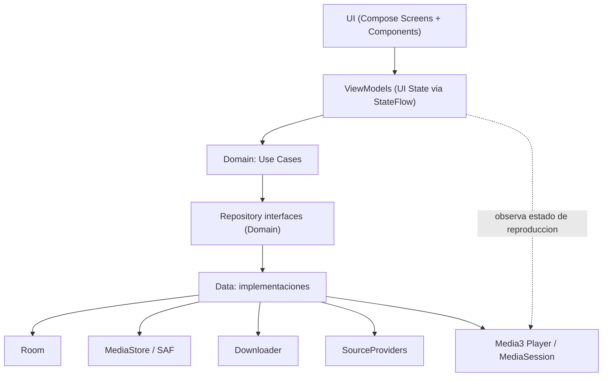
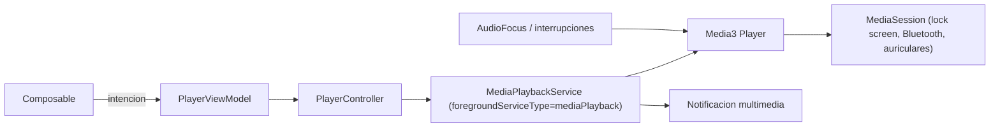
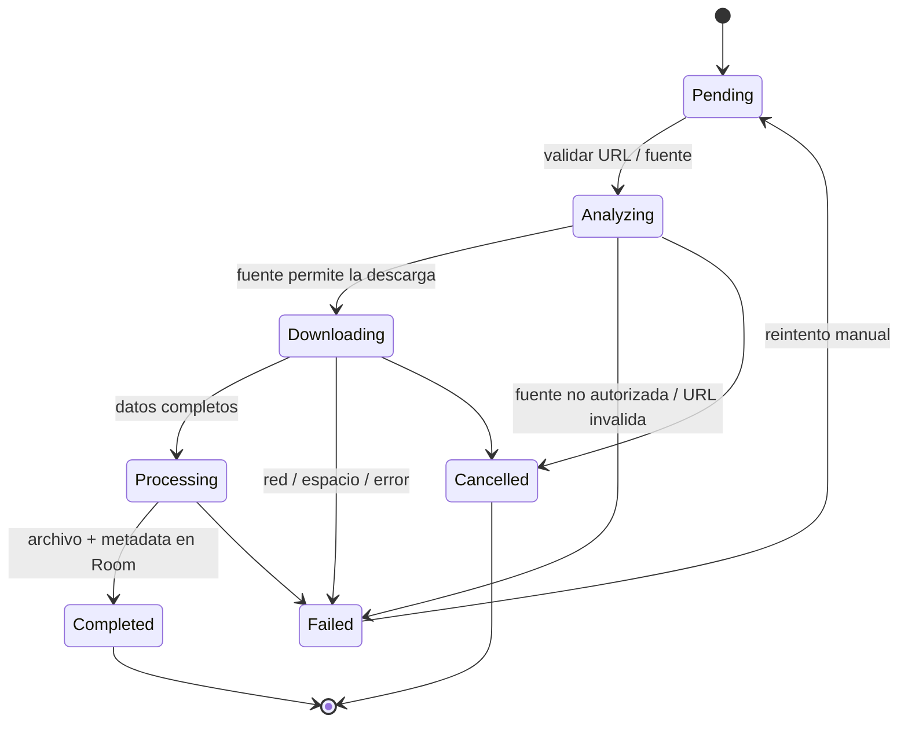

# ARCHITECTURE.md

# MI MÚSICA

Documento técnico de arquitectura.

Este documento debe mantenerse actualizado durante el desarrollo.

---

# 1. OBJETIVO

Definir la arquitectura técnica de la aplicación Android Mi Música.

La arquitectura debe permitir:

- mantenimiento;
- escalabilidad;
- testing;
- separación de responsabilidades;
- bajo acoplamiento;
- evolución independiente de componentes.

---

# 2. STACK

## Lenguaje

Kotlin

## UI

Jetpack Compose

## Design System

Material 3

## Persistencia

Room

## Reproducción

Android Media3

## Concurrencia

Kotlin Coroutines

## Streams reactivos

Kotlin Flow

## Background tasks

WorkManager cuando corresponda.

## Storage

MediaStore / APIs modernas de almacenamiento Android.

## 2.1 Justificación de cada dependencia (Fase 1)

- **Jetpack Compose + Material 3**: sistema de UI declarativo oficial de Android; render, theming (dynamic color) y estados (loading/empty/error) reutilizables sin bibliotecas de terceros.
- **Navigation Compose**: navegación declarativa integrada con Compose; evita reinventar back stack y argumentos.
- **Room**: persistencia de metadata (biblioteca, descargas, playlists) con Flow nativo; sobre SQLite directo ofrece comprobación de tipos en compilación y migraciones gestionadas.
- **Media3 (ExoPlayer + MediaSessionService)**: reemplazo único oficial de EXO/SimpleExoPlayer y compatibilidad integrada con MediaSession, notificación multimedia, audio focus y Bluetooth.
- **Coroutines + Flow**: modelo de concurrencia oficial de Kotlin; WorkManager cuando aplique para descargas diferidas/seguras tras reinicio (decisión fina en FASE 7).
- **KSP**: procesamiento anotaciones Room (opcional, lo que Room requiere por defecto).
- **MediaStore/SAF**: sin `WRITE_EXTERNAL_STORAGE`; escritura de audio con permisos mínimos (API 30+) y selección de archivos con SAF.
- **JUnit + Robolectric + Compose UI Test + androidTest**: stack de pruebas oficial sin dependencias exóticas.

No se necesita: Retrofit (no servicio REST definido aún), Hilt (DI manual en primer momento), Coil solo si se determina como necesario para carátulas (decisión Fase 2, con carga artesanal por URI local en la mayoría de casos).

---

# 3. ARQUITECTURA GENERAL

La arquitectura sigue Clean Architecture en capas (monomodulo con separacion por paquetes en Fase 3; considerar modulos Gradle solo si el tamano lo justifica):



Reglas de dependencia:

- Presentation solo conoce interfaces de Domain (nunca Room, MediaStore, Media3 ni clientes HTTP directamente).
- Domain no depende de Android salvo lo minimo imprescindible (no de Compose ni de Room).
- Data implementa las interfaces de Domain; evita dependencias circulares y duplicacion de logica.
- Comunicacion reactiva con Flow/StateFlow; corrutinas para todo trabajo bloqueante.

## 3.1 Flujo de reproduccion en segundo plano



Responsabilidades:

- El servicio de reproduccion sobrevive a la destruccion de la Activity.
- Perdida de foco de audio: pausar segun el estandar de Android. Desconexion de auriculares: pausar. Fin de cola: detener el servicio.
- Recuperacion de estado: cola y posicion persistidas para restaurar tras muerte del proceso (detalle en FASE 10).

## 3.2 Ciclo de vida de una descarga



La descarga se ejecuta fuera del hilo principal; cada estado se persiste para sobrevivir a la muerte del proceso (reanudar desde el ultimo estado conocido).

---

# 4. PRESENTATION

Responsabilidades:

- UI.
- navegación.
- estado visual.
- interacción del usuario.

Componentes:

- Composables.
- Screens.
- ViewModels.
- UI State.

La Presentation NO debe:

- acceder directamente a Room;
- ejecutar lógica de negocio compleja;
- controlar directamente detalles de descarga;
- controlar directamente Media3.

---

# 5. DOMAIN

Contiene lógica de negocio independiente de Android cuando sea posible.

Componentes:

- Models.
- Use Cases.
- Repository interfaces.

Ejemplos:

```text
AnalyzeSourceUseCase
DownloadSongUseCase
DeleteSongUseCase
GetLibraryUseCase
SearchSongsUseCase
PlaySongUseCase
```

Los nombres definitivos deben ajustarse al código real.

---

# 6. DATA

Responsable de:

- Room.
- MediaStore.
- descarga.
- metadata.
- fuentes externas.
- reproducción cuando corresponda.

Componentes previstos:

```text
database/
repository/
downloader/
media/
storage/
source/
metadata/
```

---

# 7. REPOSITORIES

Los repositories abstraen las fuentes de datos.

Ejemplo:

```text
SongRepository
DownloadRepository
SourceRepository
```

Presentation y Domain no deben depender directamente de implementaciones concretas.

---

# 8. DATABASE

Room.

Estructura prevista:

```text
database/
├── AppDatabase
├── SongDao
└── SongEntity
```

Room almacena metadata.

Los archivos de audio se almacenan fuera de SQLite.

---

# 9. STORAGE

La aplicación utilizará APIs modernas de Android.

Preferencia:

MediaStore cuando corresponda.

Los registros de Room deben guardar referencias al archivo mediante URI cuando sea apropiado.

---

# 10. DESCARGAS

La descarga debe estar desacoplada de la UI.

Flujo conceptual:

```text
UI
 ↓
ViewModel
 ↓
UseCase
 ↓
DownloadRepository
 ↓
Downloader
 ↓
Storage
 ↓
Room
```

Estados:

```text
Pending
Analyzing
Downloading
Processing
Completed
Failed
Cancelled
```

---

# 11. FUENTES

Las fuentes deben abstraerse mediante interfaces.

Conceptualmente:

```text
SourceProvider
      │
      ├── Provider A
      ├── Provider B
      └── Provider C
```

Esto permite cambiar o agregar fuentes sin modificar toda la aplicación.

Las fuentes deben cumplir las restricciones legales y técnicas aplicables.

---

# 12. AUDIO

El sistema debe distinguir:

```text
Fuente
   │
   ├── formato
   ├── bitrate
   └── duración
          │
          ▼
Procesamiento
          │
          ▼
Archivo final
```

No asumir que un bitrate mayor implica mejor calidad.

## 12.1 Identificación de formato y calidad (sin inflar la calidad real)

- Formato fuente: detectado desde los metadatos reales del archivo/flujo (`MediaExtractor` / `MediaFormat`, o APIs de Media3 para flujos) — nunca deducido de la URL ni de suposiciones del proveedor.
- Bitrate fuente: leído del stream real cuando está disponible; si no, se marca `unknown` en Room y en la UI. Prohibido mostrar un número que la fuente no entregó.
- Formato final: igual al de la fuente cuando el dispositivo lo reproduce sin transcódigo (copia directa del stream / remux). Conversión solo por compatibilidad o petición explícita del usuario, y documentada con el bitrate real resultante.
- Regla anti-inflado: la app muestra la calidad REAL de la fuente. Nunca "320 kbps" heredado de etiquetas falsas ni conversión a bitrate alto como marketing.

---

# 13. REPRODUCTOR

Media3 será responsable de la reproducción.

Arquitectura conceptual:

```text
UI
 ↓
PlayerViewModel
 ↓
PlayerController
 ↓
Media3
 ↓
MediaSession
```

El reproductor debe poder continuar funcionando aunque la UI sea destruida.

---

# 14. BACKGROUND PLAYBACK

La reproducción en segundo plano debe estar desacoplada de Activity/Composable.

Utilizar las APIs modernas recomendadas por Android.

Componentes previstos:

- MediaSession.
- Player.
- servicio de reproducción cuando sea necesario.
- notification.

---

# 15. NAVEGACIÓN

Navegación prevista (Fase 1, ver DESIGN.md):

```text
App
│
├── Home
├── Library
├── Playlists (nuevo: creación/edición de listas)
├── Downloads
└── Settings
```

Player puede funcionar como pantalla independiente y/o bottom sheet según el diseño final.

---

# 16. UI/UX

La arquitectura visual debe definirse mediante UI/UX Pro Max.

Componentes reutilizables previstos:

```text
components/
├── SongCard
├── MiniPlayer
├── DownloadProgress
├── EmptyState
├── ErrorState
├── LoadingState
└── ...
```

No crear duplicados de componentes.

---

# 17. MODELOS

Modelo principal:

```text
Song
```

Información prevista:

```text
id
title
artist
album
duration
fileUri
fileSize
mimeType
bitrate
artworkUri
sourceUrl
downloadedAt
lastPlayedAt
```

Los campos definitivos pueden cambiar durante la implementación.

---

# 18. DEPENDENCY INJECTION

**Decisión (Fase 1): DI manual** (una `AppContainer` / Application-scoped container que construye y expone dependencias) mientras el proyecto sea monomódulo y pequeño.

Ventajas: sin dependencias extra, sin procesamiento de anotaciones, control explícito y fácil testing mediante construcción manual de `Fake` en tests.

Reglas de evolución:
- No usar acceso estático global ni singleton informal; pasar dependencias explícitamente (constructor).
- Si se crea un segundo módulo Gradle o el número de ViewModels crece de forma notable, evaluar migración a Hilt (documentando decisión anterior, nueva y motivo en este archivo).

---

# 19. TESTING

Testing por capas:

```text
Domain
 ↓
Unit Tests

Data
 ↓
Repository / Database Tests

Presentation
 ↓
ViewModel Tests

UI
 ↓
UI Tests
```

---

# 20. SEGURIDAD

Principios:

- validar entrada;
- sanitizar archivos;
- evitar path traversal;
- evitar command injection;
- no ejecutar comandos arbitrarios;
- no almacenar secretos;
- minimizar permisos;
- minimizar datos externos.

---

# 21. PERFORMANCE

Prioridades:

- UI fluida;
- evitar trabajo en Main Thread;
- controlar memoria;
- controlar imágenes;
- evitar consultas innecesarias;
- evitar recrear reproductores;
- controlar descargas concurrentes.

---

# 22. DECISIONES DE BUILDS Y STACK (RESUELTAS EN FASE 1)

Decisiones tomadas a partir de la FASE 0 y la documentación oficial de Android (revisada el 2026-10-27, AGP 9.4.0 — septiembre 2026):

| Elemento | Decisión | Motivo |
|---|---|---|
| AGP | 9.4.x | Última versión estable con compatibilidad hasta API 37 (coincide con la plataforma instalada). |
| Gradle | Wrapper 9.6.0+ | Requerido por AGP 9.4; no hay instalación global, se usará `gradlew`. |
| JDK para ejecutar Gradle | JBR de Android Studio (OpenJDK 25.0.3) | AGP requiere mínimo JDK 17; JBR 25 cumple. No se necesita desinstalar ni cambiar Java. Si Gradle emitiera advertencias de toolchain, se fijará Java toolchain 17 explícito. |
| Java toolchain / target | 17 (explícito) | Estándar recomendado por la documentación; evita divergencia entre máquinas. |
| compileSdk | 37 | Única plataforma instalada y máxima soportada por AGP 9.4. |
| targetSdk | 36 (propuesta) | Conservador: 36 evita exposición temprana a cambios de comportamiento del SDK más reciente; se revisará en Fase 3 según el comportamiento en el AVD API 37. |
| minSdk | 26 (propuesta) | Da acceso a MediaSession/APIs de audio modernas y reduce la complejidad de permisos legacy; propuesta a validar en Fase 3. |
| Kotlin | Versión recomendada por AGP 9.4 (línea 2.x), fijada en Fase 3 | No inventar número: se fijará al crear el proyecto con la versión que el AGP y el catálogo oficial indiquen. |
| Dependency Injection | DI manual en primer momento; Hilt opcional si el proyecto crece | El proyecto es monomódulo inicial; Hilt añade procesamiento de anotaciones y complejidad de build. Koin descartado por no ser el estándar de Google. Se decidirá de forma definitiva en Fase 3 antes del primer ViewModel. |

# 22.5 VERSIONES VERIFICADAS EN CONSTRUCCIÓN REAL (FASE 3)

Compilación verificada el 2026-10-27 con `gradlew.bat assembleDebug` → BUILD SUCCESSFUL.

| Elemento | Valor real | Fuente de la decisión |
|---|---|---|
| Gradle | 9.6.0 (wrapper: gradle-9.6.0-bin.zip) | Compat oficial AGP 9.4: mínimo Gradle 9.6.0. |
| Gradle interno (reportado por gradlew --version) | Kotlin 2.3.21 / Groovy 4.0.32 | Solo afecta scripts Gradle, no el proyecto. |
| JVM ejecutando Gradle | JBR OpenJDK 25.0.3 (`C:\Program Files\Android\Android Studio\jbr`) | ≥ mínimo JDK 17 de AGP; no cambió JDK. |
| AGP | com.android.application 9.4.0 (version catalog) | Documentación AGP 9.4.0 (sept 2026). |
| Kotlin | Built-in Kotlin de AGP 9 (KGP interno, sin `kotlin-android` aplicado) | Doc "Migrate to built-in Kotlin". |
| Compose Compiler | org.jetbrains.kotlin.plugin.compose 2.2.10 | Alineado con KGP mínimo de AGP 9 (doc AGP 9.0 release notes). |
| Compose BOM | 2026.09.00 | Doc "Setup Compose dependencies and compiler" (recomendación vigente). |
| compileSdk | 37 | Máxima soportada por AGP 9.4 y única plataforma instalada. |
| targetSdk | 36 (explícito) | Conservador; no heredado de compileSdk (propietario de AGP 9: default = compileSdk si no se fija). |
| minSdk | 26 (propuesto, pendiente validación) | Decisión FASE 1; se valida en una fase posterior. |
| Java target del proyecto | 17 (`compileOptions.source/targetCompatibility`) | Recomendación oficial; negocio distinto del JDK que ejecuta Gradle. |
| Repositorio de los módulos | proyecto monomódulo `:app`, namespace `com.example.mimusica` | Estructura estándar. |

ADVERTENCIA del entorno: el emulador no funciona por falta de aceleración/hipervisor — queda pendiente para las fases que necesitan pruebas en pantalla; alternativa: dispositivo físico.

## 22.6 Compatibilidad resumida (verificada)

```text
JBR 25.0.3 (instalado)  ✓ mayor que el mínimo JDK 17 requerido por AGP 9.4
Gradle 9.6.x            ✓ requerido por AGP 9.4 (se usará wrapper, no instalación global)
AGP 9.4                 ✓ compatible con compileSdk 37 (máxima soportada)
java toolchain = 17     ✓ límite de lenguaje/API de Java para fuentes del proyecto
```

No se requiere desinstalar ni modificar ninguna instalación Java existente.

---

# 22.3 DECISIONES PENDIENTES (POST-FASE 1)

- [ ] Confirmar `minSdk` exacto (propuesta: 26) — FASE 3.
- [ ] Confirmar la versión exacta de Kotlin que seleccione el AGP final.
- [ ] Confirmar `targetSdk` definitivo (propuesta: 36).
- [ ] Confirmar fuentes compatibles finales y diseño del Player (pantalla completa vs bottom sheet).
- [ ] Confirmar estrategia definitiva de descarga (HTTP directo vs WorkManager según restricciones reales).
- [ ] Fuentes: documentar las operaciones permitidas en cada proveedor (ver 22.2).

## 22.2 Fuentes y restricciones

No se implementará ningún mecanismo que eluda DRM, autenticación, paywall ni restricciones técnicas de una fuente.

Reglas de diseño para `SourceProvider`:
- Cada proveedor declarado debe documentar qué operaciones permite oficialmente la fuente; no se implementará ninguna operación no autorizada. Si la fuente no declara una vía permitida, la acción no se expondrá en la UI.
- Para YouTube y servicios similares: la app no presupone poder descargar; se analizará únicamente si existe una vía oficial legítima. Sin esa verificación explícita, YouTube/YouTube Music no estarán entre las fuentes activas.
- Fuente universal siempre disponible: importar archivos ya presentes en el dispositivo (no requiere red y no depende de terceros).


---

# 23. HALLAZGOS DE LA FASE 0 — INSPECCIÓN DEL ENTORNO

Análisis realizado el 2026-10-27. No se implementó ningún código.

## 23.1 Entorno físico detectado

| Componente | Versión / Detalle | Ruta |
|---|---|---|
| Sistema Operativo | Windows 10 Pro 64-bit (10.0.19045) | — |
| JDK (JBR integrado) | OpenJDK 25.0.3 (bundled Android Studio) | C:\Program Files\Android\Android Studio\jbr |
| JDK (otra versión disponible) | jre1.8.0_511 | C:\Program Files\Java |
| Android Studio | AI-262.9437.185.2621.16467767 | C:\Program Files\Android\Android Studio |
| Android SDK | ✔ | C:\Users\x\AppData\Local\Android\Sdk |
| Platform | android-37.0 (única instalación) | %SDK%\platforms |
| Build-tools | 36.0.0 | %SDK%\build-tools |
| Platform-tools / adb | 37.0.1-15733141 | %SDK%\platform-tools |
| Emulador | ✔ Instalado | %SDK%\emulator |
| Imagen de sistema | API 37, Google APIs + Play Store, x86_64 | %SDK%\system-images\android-37.0 |
| AVD | Medium_Phone (API 37, Android 16) | C:\Users\x\.android\avd\Medium_Phone_API_37.0.ini |
| Licencias SDK | ✔ Aceptadas | %SDK%\licenses |
| Gradle (standalone) | ✖ No instalado | — |
| Kotlin (standalone) | ✖ No instalado | — |
| adb disponible globalmente en PATH | ✖ | — |
| JAVA_HOME / ANDROID_HOME / ANDROID_SDK_ROOT | ✖ No configurados | — |

## 23.2 Dispositivos y emuladores

- No hay dispositivo físico Android conectado (adb devices → vacío).
- Hay 1 AVD disponible y listo para uso: `Medium_Phone_API_37.0` (Android 16, x86_64 con Google Play Store).

## 23.3 Versión de Kotlin / Gradle / AGP

- Kotlin: no detectado como herramienta independiente. Se establecerá mediante el plugin de Kotlin en la configuración Gradle del proyecto cuando se cree (FASE 3). No inventar el número antes de la resolución oficial de dependencias.
- Gradle: no está instalado globalmente. El proyecto usará Gradle Wrapper (`gradlew`), cuya versión se fijará al crear el proyecto (el AGP recomendado lo define).
- AGP: la instalación de Android Studio apunta internamente a componentes "aapt2-proto-8.1.0" (indicio del AGP 8.1.x en la distribución), pero la espinestra y versiones compatibles oficiales se definirán automáticamente al crear el proyecto. No fijar la versión a mano antes de eso.
- `aapt2.exe` versión 2.20-13193326 bajo build-tools 36.0.0.

## 23.4 Skills disponibles

Skills accesibles en este entorno: `anatomy`, `find-skills`, `graphify`, `opencode`, `report`, `reverse-engineer-anything`.

Referidas por AGENTS.md pero NO implementadas / NO accesibles:

- ✖ `UI/UX Pro Max` — no está disponible.
- ✖ `Graphity` — no está disponible. Existe `graphify`, que sirve para construir gráfos de conocimiento sobre repositorios; NO es una skill de diseño de diagramas visuales y no sustituye la intención original descrita en AGENTS.md.

Sugerencia: en la FASE 1/2 se puede usar `find-skills` para buscar si existe alguna skill equivalente instalable; en caso contrario, se procederá con principios de Material 3 de forma manual.

## 23.5 Existencia de proyecto Android

El directorio `H:\Proyectos code\Donwloader` contiene SOLO 3 archivos:

```text
AGENTS.md
PLAN.md
ARCHITECTURE.md
```

- NO existe:
  - `settings.gradle` ni `build.gradle`;
  - carpeta `app/` o `src/`;
  - `gradle.properties`;
  - `AndroidManifest.xml`;
  - código Kotlin, Java o recursos XML;
  - archivo `.idea/` o configuración de proyecto Android Studio.
- No existe control de versiones Git (el directorio NO es un repositorio).

Conclusión: NO existe ningún proyecto Android todavía. La FASE 3 (Proyecto Android Base) deberá crearlo desde cero.

## 23.6 Análisis de código existente

No hay código fuente que analizar.

---

# 24. REGLA DE ACTUALIZACIÓN

Cada cambio arquitectónico importante debe actualizar este documento.

Si una decisión reemplaza otra:

Documentar:

- decisión anterior;
- nueva decisión;
- motivo;
- impacto.

---

# 25. PRINCIPIO GENERAL

La aplicación debe seguir:

```text
Simple > Complejo
Mantenible > Rápido
Comprobado > Supuesto
Reutilizable > Duplicado
Seguro > Conveniente
```