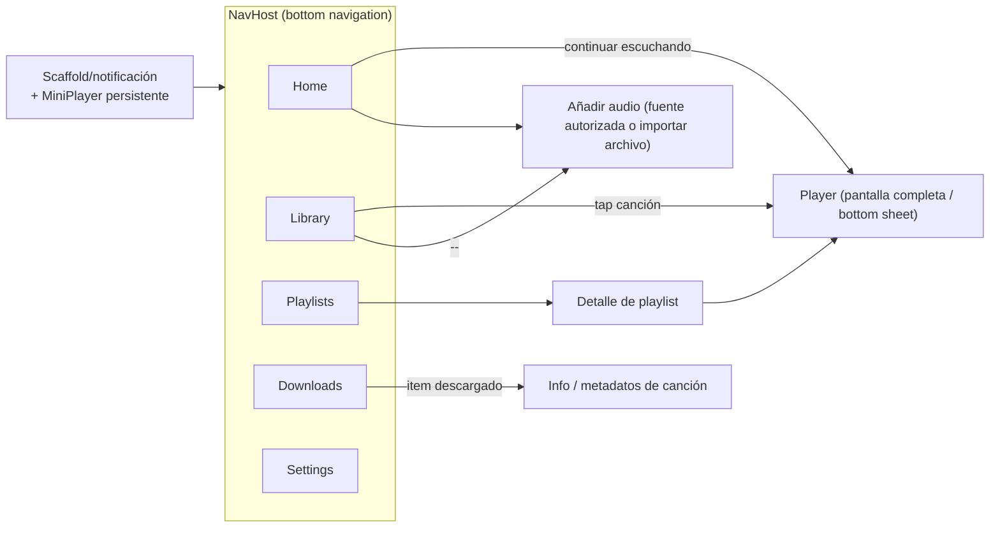

# DESIGN.md

# MI MÚSICA — Especificación de interfaz, navegación y estados

Fase 1 — Diseño. Sin código de producción. Este documento describe QUÉ se construirá, no CÓMO se codifica.

---

# 1. IDENTIDAD Y PRINCIPIOS DE UX

- Aplicación offline-first: la biblioteca local es el centro de la experiencia.
- Material 3, Material You (dynamic color en API 31+) con fallback estático — especificación completa en **DESIGN_SYSTEM.md**.
- Tipografía: Roboto (escala M3), sin fuentes externas.
- Regla transversal: ningún estado de pantalla queda indefinido. Toda pantalla define Loading / Success / Empty / Error / Processing según aplique (matriz por pantalla en DESIGN_SYSTEM.md §7).
- Regla de calidad de audio: solo datos reales de la fuente; prohibido inflar o "mejorar"(ver DESIGN_SYSTEM.md §8).

---

# 2. MAPA DE NAVEGACIÓN



- Navegación con Navigation Compose; bottom bar con 5 destinos (Home, Library, Playlists, Downloads, Settings).
- MiniPlayer persistente sobre la bottom bar cuando hay reproducción activa; tap abre Player.
- Player puede abrirse como bottom sheet expandible; decisión final de patrón (pantalla vs sheet) se valida con prototipo en Fase 2.

---

# 3. PANTALLAS Y ESTADOS

## 3.1 Home

- «Continuar escuchando» (últimas reproducciones), cola reciente, accesos rápidos.
- Estados: Loading (spinners/esqueleto) · Error (mensaje + reintento) · Empty (primera vez: CTA «Añadir música») · Success.

## 3.2 Library

- Lista de canciones con portada, título, artista, duración. Barra de búsqueda, orden, filtros (artista/álbum). Acción: reproducir, añadir a playlist, eliminar.
- La disponibilidad del archivo se comprueba bajo demanda por canción. Mostrar estados de comprobación, archivo disponible, ausente, sin acceso o no válido; una comprobación nunca elimina el registro ni el archivo físico.
- Estados: Loading · Empty («Tu biblioteca está vacía» + CTA) · Error (acceso a datos fallido, con reintento) · Success. Operaciones masivas → estado Processing.

## 3.3 Playlists

- Lista de listas de reproducción; crear, renombrar, eliminar, reordenar.
- Detalle: canciones de la playlist, quitar/ordenar, reproducir todo.
- Estados equivalentes al resto.

## 3.4 Downloads

- Cola activa y descargas completadas, con progreso y estados por ítem: `Pending · Analyzing · Downloading · Processing · Completed · Failed · Cancelled`. Reintentar / cancelar siempre visibles en estados que lo permitan.

## 3.5 Player (pantalla completa)

- Portada grande, título/artista, barra de seek, play/pausa, siguiente, anterior, ±10 s, cola contextual.
- Transmite estado del reproductor (no posee lógica de reproducción).

## 3.6 Añadir audio

- Dos vías claramente separadas:
  1) **Importar archivo local** del dispositivo (SAF/document picker) — siempre disponible.
  2) **Añadir desde fuente compatible** — solo si la fuente permite oficialmente la operación; cada fuente declarada debe documentar qué permite oficialmente. Para YouTube y servicios equivalentes: no se presupone ningún mecanismo de descarga; si no existe vía autorizada, esa pestaña no habilita acciones.
- Estados: Idle · Analyzing (validación de URL/origen) · Downloading (solo fuentes que lo permitan) · Error (URL inválida, fuente no autorizada, sin red, sin espacio) · Success.

## 3.7 Settings / Ajustes

- Calidad predeterminada, Wi-Fi solamente, tema (sistema/claro/oscuro), almacenamiento info, temporales, acerca de.

---

# 4. COMPONENTES REUTILIZABLES

```text
components/
├── SongCard / SongListItem      (portada, título, artista, duración, menú contextual)
├── MiniPlayer                   (persistente, barra inferior)
├── DownloadProgress             (estado + progreso + acciones)
├── EmptyState                   (icono + texto + CTA opcional)
├── ErrorState                   (mensaje accionable + reintento)
├── LoadingState                 (esqueleto legible)
├── SeekBar                      (controlado por el estado del Player)
├── PlaylistCard
└── ConfirmDialog                (eliminaciones)
```

Regla: prohibido duplicar; cualquier pantalla nueva parte de estos componentes. Especificación visual detallada de cada componente: **DESIGN_SYSTEM.md §5**. Wireframes textuales por pantalla: **DESIGN_SYSTEM.md §6**.

---

# 5. PERMISOS Y CASOS DE ERROR DE SISTEMA

| Permiso / situación | Estrategia |
|---|---|
| Notificaciones (API 33+) | Se pide solo al activar background playback, con rationale previa; app funciona sin ella (solo sin notificación). |
| Foreground media playback | Sin permiso especial: uso del tipo `mediaPlayback` con las restricciones del sistema. |
| Almacenamiento | Nada de WRITE_EXTERNAL_STORAGE legacy: MediaStore (add/write sin permiso en API 30+) y SAF para importar. |
| Acceso a archivos existentes | Acceso a URI a través del Resolver/SAF, con detección de URI revocada. |

Casos de error de sistema definidos (modelo de errores del dominio): sin espacio, URI perdida/eliminada, archivo corrupto, sin red (solo para fuentes), audio enfocado perdido, codec no soportado. Cada uno tiene mensaje accionable en UI.

---

# 6. AUDIO Y CALIDAD — REGLA SIN «INVENTO» DE CALIDAD

- La calidad final nunca puede superar a la fuente. Se registra siempre: formato fuente, bitrate fuente, formato final, bitrate final, duración.
- Si la fuente no expone bitrate/formato, la app NO declarará calidad (mostrará "desconocida"); nada de asumir "320 kbps".
- Conversión transcodificadora solo cuando sea estrictamente necesaria (p. ej. compatibilidad de formato), preservando la calidad fuente; preferencia por copiar el stream de audio tal cual cuando el formato ya es compatible.
- Metadatos y portada se escriben únicamente si el formato de destino los soporta; si no, quedan en Room y en una caché de imágenes, sin manipular el archivo de audio.

---

# 7. PRUEBAS (plan por nivel)

- Unit (JUnit): use cases, parsers/sanitizadores de nombres, modelo de calidad de audio, lógica de cola de descarga (repo con fakes).
- ViewModel tests: estados de cada pantalla (Loading/Empty/Success/Error), ej. con fakes de repositorios.
- Database tests (Room in-memory): migraciones y DAOs.
- Repository/integration: storage con MediaStore runner en Robolectric, downloader con cliente de red falso.
- UI/Compose tests: navegación entre 5 pestañas, empty states, flujo de añadir-a-playlist, controles del Player con estados simulados.
- Instrumentación/dispositivo: reproducción real con Media3 en el AVD `Medium_Phone_API_37.0` y (cuando haya dispositivo) interrupciones: desconexión de auriculares vía eventos del sistema, notificación de sesión en lock screen, pérdida de foco de audio por llamadas u otra app.

---

# 8. CRITERIOS DE ACEPTACIÓN (Fase 1)

1. ARCHITECTURE.md actualizado con capas, módulos y diagramas (este entregable).
2. DESIGN.md con navegación, pantallas, estados y componentes definidos (este entregable).
3. PLAN.md actualizado con entregables y criterios de Fase 1.
4. Combinación Gradle/AGP/JDK documentada y verificada contra documentación oficial (AGP 9.4 + Gradle 9.6 + JDK 17+ (JBR 25 válido), compileSdk 37).
5. Ninguna dependencia propuesta sin justificación.
6. Sin código de producción creado.

---

# 9. RIESGOS Y PENDIENTES

| Riesgo / pendiente | Mitigación / decisión en Fase 1 |
|---|---|
| No hay UI/UX Pro Max disponible | Se sigue Material 3 manual + componentes propios. Sugerido: opcionalmente probar `find-skills` en Fase 2. |
| YouTube: sin vía autorizada de descarga | Funcionalidad «fuente compatible» queda condicionada a soporte oficial; sin implementación de bypass. |
| JDK 25 + Gradle 9.6 | Soportado (AGP pide ≥17); si aparece advertencia de toolchain, se fijará toolchain 17. |
| Espacio de disco insuficiente | Verificación previa a la descarga: tamaño estimado vs. espacio libre. Nombres sanitizados, path traversal bloqueado. |
| Definición final de colores, tipografía y sistemas visuales | Se concreta en FASE 2 (Sistema UI/UX). |
