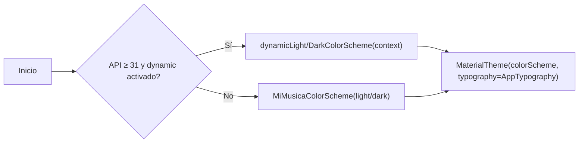

# DESIGN_SYSTEM.md

# MI MÚSICA — Sistema visual (Material 3)

Fase 2 — Especificación implementable con Jetpack Compose `material3`. Sin código creado todavía.

Base: especificación oficial de Material 3 (fuente: M3 Design Guidance de developer.android.com). Nota: la skill UI/UX Pro Max NO está disponible; se buscó con `find-skills` (resultados Android/UX con ≤2 instalaciones, no confiables → descartados).

---

# 1. COLOR

## 1.1 Estrategia

1. **Dynamic Color (Material You)** en API 31+: la app deriva toda su paleta de un color semilla (`colorSeed`) del wallpaper mediante `dynamicLightColorScheme` / `dynamicDarkColorScheme`.
2. **Fallback estático** en API < 31 o cuando dynamic color está desactivado en Ajustes: `ColorScheme` personalizada definida abajo con tono semilla verde-musgo (sensación "biblioteca musical", no clon de Spotify).



## 1.2 Paleta estática de respaldo (light/dark)

| Token M3 | Light | Dark | Rol semántico |
|---|---|---|---|
| primary | #2D6E4A | #8ADB9E | Acciones, play activo, tabs activo |
| onPrimary | #FFFFFF | #00391C | — |
| primaryContainer | #B2F1C2 | #15502F | Chips seleccionados, aviso "en reproducción" |
| onPrimaryContainer | #00210E | #B2F1C2 | — |
| secondary | #4E6355 | #B0CCB7 | Controles secundarios, seeks inactivos destacados |
| tertiary | #3A6673 | #A2CEDC | Etiquetas de formato/ calidad, enlaces |
| error | #BA1A1A | #FFB4AB | Errores, estado Failed |
| errorContainer | #FFDAD6 | #93000A | Fondos de banner de error |
| surface | #FCFDF8 | #1A1C1A | Fondos de pantalla |
| surfaceContainer | #F0F1EB | #242824 | Cards, mini-player, cabeceras |
| outlineVariant | #C4C8C1 | #434742 | Divisores, bordes |
| scrim | #000000 60% | #000000 60% | Sobre portada en Player |

Regla: TODO color pasa por el `ColorScheme` (nada hardcodeado), así dynamic color o el modo alto-contraste del sistema funcionan sin cambios de código.

## 1.3 Colores semánticos de estados de descarga

| Estado | Token usado |
|---|---|
| Pending | onSurfaceVariant (icono schedule) |
| Analyzing | tertiary (icono insights) |
| Downloading | primary (progreso indeterminado→determinado) |
| Processing | secondary (icono graphic_eq) |
| Completed | primaryContainer (icono check) |
| Failed | error / errorContainer (icono error + acción Reintentar) |
| Cancelled | onSurfaceVariant tachado + acción Reintentar |

## 1.4 Semántica de color

- Señalar alto contraste: respetar `Settings > contrast` no requiere tokens extra si todo usa ColorScheme; verificar en revisión de accesibilidad.
- "Wi-Fi solamente" en progreso de descarga: badge con tertiary.

---

# 2. TIPOGRAFÍA

Escala Material 3 con `Typeface` por defecto Roboto). Se define `AppTypography` (sin fuentes externas: evita bloat del bundle).

| Estilo | Size / lineH | Weight | Uso |
|---|---|---|---|
| displaySmall | 36 / 44 | Regular | Título de Player (canción) |
| headlineSmall | 24 / 32 | SemiBold | Título de pantalla |
| titleMedium | 16 / 24 | SemiBold | Nombre de canción en lista |
| bodyMedium | 14 / 20 | Regular | Artista, detalles, cuerpo |
| bodySmall | 12 / 16 | Regular | Duración, bitrate, fecha |
| labelLarge | 14 / 20 | Medium | Botones, chips邀 |
| labelSmall | 11 / 16 | Medium | Badges (formato en SongCard) |

Texto largo (reglas transversales):
- Artistas/álbumes largos → `maxLines = 1`, `overflow = Ellipsis`. Solo el título de la canción en Player usa 2 líneas con ellipsis y scroll vertical si no cabe.
- Descripciones largas (vacías/errores) → bodyMedium con `maxLines=3` + tap para ver mensaje completo.
- Todos los textos escalan con la preferencia de tamaño del sistema (Compose lo respeta nativamente); no se usa px; siempre sp.

---

# 3. ESPACIADO, FORMA Y ELEVACIÓN

## 3.1 Espaciado (escala 4 dp)

```text
4 · 8 · 12 · 16 · 24 · 32 · 48
```

- Padding de pantalla: 16 dp (24 dp en pantallas de Player).
- Separación entre ítems de lista: 0 dp (listas con divisores outlineVariant claro, alturas 48-72 dp).
- Separación entre secciones: 24 dp.

## 3.2 Forma (shape)

| Token | Radio | Uso |
|---|---|---|
| extraSmall | 4 | Badges |
| small | 8 | Chips |
| medium | 12 | Song/Playlist cards |
| large | 16 | Mini-player, diálogos |
| full | 50% | Botones FAB, avatares de artista, iconos de estado |

## 3.3 Elevación

| Nivel | dp | Uso |
|---|---|---|
| 0 | 0 | Contenido normal (tonal elevation en surfaceContainer) |
| 1 | 3 | Cards presionadas |
| 2 | 6 | Mini-player, FAB |
| 3 | 8 | Diálogo, NavigationBar elevada en scroll |

Material 3 usa preferentemente tonal elevation (superficies con tinte del primary); sombras solo para elementos "flotantes".

## 3.4 Iconografía

- Material Symbols/Icons (Outlined por defecto, Rounded alternativo interno en Player).
- Tamaño estándar 24 dp; 20 dp en tab bar; 48 dp de contención táctil mínimo.

---

# 4. TÁCTIL Y ACCESIBILIDAD

- Mínimo de interacción: 48×48 dp en TODO elemento acción (Material a11y + guía Android).
- Targets de acción separados ≥ 8 dp; menú desplegable (`DropdownMenu`) para acciones secundarias de lista (reproducir, añadir a playlist, eliminar) en lugar de botones en cascada.
- Content descriptions ES/EN obligatorios en todo icono acción (portada: texto alternativo "Portada de {título}").
- Semántica Play/Pausa: `semantics { stateDescription }` en botón de reproducción ("Reproducir"/"Pausar").
- Contraste: mensaje de error siempre en `error` sobre `surface` o `errorContainer` con contraste M3 garantizado por la paleta.
- Nada de informar solo con color: badges de error llevan SIEMPRE icono + texto.
- Gesture: swipe para eliminar/ocultar debe tener acción "Deshacer" (snackbar).
- Adaptativo: layout para teléfonos compactos; verificación en pantallas landscape y `Medium_Phone_API_37.0` (folded/resizable) en pruebas.

---

# 5. COMPONENTES REUTILIZABLES (especificación visual)

| Componente | Especificación visual |
|---|---|
| **SongListItem** | 56-72 dp de alto: portada 48x48 (shape medium, fallback: icono music_note sobre surfaceContainer si no hay carátula), título (titleMedium, 1 línea), artista·duración (bodySmall), menú de contexto (3 puntos). Badge opcional de formato (labelSmall, tertiaryContainer). |
| **SongCard (Home grid)** | 2 columnas: portada cuadrada (shape medium), título 1 línea, artista 1 línea, altura fija; FAB seleccionable (no persistente). |
| **MiniPlayer** | Barra 64 dp sobre la NavigationBar: portada 44, título/artista 1 línea, play/pause 48 dp, next 48 dp. On tap expandir a Player. |
| **SeekBar** | altura de slider M3, thumb siempre visible cuando tiene foco; duración transcurrida/restante (bodySmall). La línea del slider refleja el estado real del reproductor. |
| **PlaylistCard** | Mosaico de 2x2 portadas o fondo primaryContainer con icono playlist, título y nº de canciones. |
| **EmptyState** | Icono 48 dp neutral (onSurfaceVariant), título (titleMedium), descripción (bodyMedium, máx 3 líneas), CTA opcional (`FilledTonalButton`). Composición vertical centrada con 24 dp de padding. |
| **ErrorState** | Icono error, título, mensaje accionable, botón `Reintentar`. Variante banner con errorContainer para errores de fondo. |
| **LoadingState** | Esqueleto (mismas formas que la lista: rects redondeados con animación shimmer tonal). Sin spinner global en listas. |
| **DownloadProgressItem** | Card con estado e icono (ver §1.3), barra linear, texto de progreso "3.2 MB / 8 MB · 429 kbps" SOLO con datos reales, acciones Reintentar/Cancelar por estado. |
| **ConfirmDialog** | Dialog M3 estándar, para eliminar canción/playlist; opcional "Eliminar también el archivo" con explicación del efecto. |
| **QualityBadge** | Chip labelSmall: "Opus · 160 kbps" o "Formato no identificado" (nunca números inventados). |

---

# 6. PANTALLAS Y WIREFRAME

> Los siguientes wireframes REPRESENTAN la intención; no están implementados.

## 6.1 NavigationBar (global)

```text
┌──────────────────────────────────────────┐
│ (pantalla activa)                        │
│  ...                                     │
│ [MiniPlayer (si hay reproducción)]       │
│──────────────────────────────────────────│
│  Home   Library   Plistas .Descarg  Ajust│
└──────────────────────────────────────────┘
```

## 6.2 Home

```text
 Inicio ▾                          [búsqueda]
 ─ Continuar escuchando
 ┌────┐┌────┐
 │img ││img │  (SongCard, scroll horizontal)
 └────┘└────┘
 ─ Cola reciente
  ▶ Añadido ayer        [estado del ítem]
 ─ Atajos
  📚 Biblioteca   ⬇ Descargas   ＋ Añadir música
```

## 6.3 Library

```text
 Biblioteca               [≡ filtros]
 ┌─────────────────────────────────────┐
 │ 🔍 Buscar canción, artista o álbum │  ← SearchBar full-width
 └─────────────────────────────────────┘
 Orden: ▾ (Título/Artista/Añadido reciente)
 ────────────────────────────────────
 [♪] Nova Life      Kele · 3:12     ⋮   (hi-fi badge "FLAC · 946 kbps")
 [♪] Blue Wave      Petty · 2:58    ⋮   (Opus · 160 kbps)
 ...
 ┌─────────────────────────────────────┐
 │ FAB (+) Añadir música (importar/fuente compat) │
 └─────────────────────────────────────┘
```

- Búsqueda activa → filtra por título/artista/álbum en vivo sobre la consulta Room con `Flow` (debounce 300 ms).
- Selección múltiple (long-press) solo si se hace de una vez en FASE 9; mantener fuera del MVP visual por decisión de simplificación.

## 6.4 Player (pantalla completa / bottom sheet expandible)

```text
 ┌───────────────────────────┐
 │ ▾              ⋮          │  ← colapsar sheet, añadir a playlist
 │      ┌───────────┐        │
 │      │  portada   │        │  ← forma medium, hasta tocar la superficie
 │      └───────────┘        │
 │ Canción (2 líneas máx)    │
 │ Artista · Álbum           │
 │      ◁━●═══════▷          │
 │ 1:42            3:12      │
 │   shuffle ◁ play ▷ repeat │
 │      −10s      +10s       │
 │ Controles supplementary    │
 └───────────────────────────┘
```

## 6.5 Añadir audio (fuente compatible)

```text
 ┌──────────────────────────────┐
 │ Añadir música                       │
 │ [ Importar del dispositivo ]        │  ← SAF, siempre disponible
 │ ── o ──                              │
 │ Añadir desde fuente                  │
 │ ┌─────────────────────────────────┐ │
 │ │ Pegar la URL compatible         │ │
 │ └─────────────────────────────────┘ │
 │ Solo fuentes que oficialmente        │
 │ permiten la operación.               │
 │ [Analizar]                           │
 └─────────────────────────────────────┘
```

- Al analizar se muestra la metadata REAL detectada (formato/bitrate solo si la fuente la reporta).
- Si la fuente no permite descarga oficial → sin botón "Descargar"; mostrar explicación.

## 6.6 Detalle de playlist / Playlists

```text
 Playlists           [＋]
 □ días soleados        12 canciones
 □ rock instrumental     8 canciones
 ──────────────────────────────────
 (Detalle: header con nombre + reproducir todo, reordenar (move handle 48dp),
  eliminar por menú con ConfirmDialog)
```

## 6.7 Settings

```text
 Ajustes
 ▾ Reproducción
   Calidad: "Usar calidad de la fuente" (única opción honesta por defecto)
 ▾ Descargas
   Wi-Fi solamente        [✓ switch]
   …
 ▾ Apariencia
   Tema: Sistema / Claro / Oscuro
   Dynamic Color          [✓] (ausente en API<31)
 ▾ Almacenamiento
   Uso actual, carpeta, temporales (limpiar)
 ▾ Acerca de
```

---

# 7. ESTADOS POR PANTALLA (matriz final)

| Pantalla | Loading | Empty | Error | Success | Processing |
|---|---|---|---|---|---|
| Home | esqueleto cards | CTA "Añadir música" | snackbar + retry sección Failed | contenido | indicador progreso de descarga activa |
| Library | esqueleto list | EmptyState + CTA | ErrorState retry | lista | spinner en eliminación masiva (por ítem) |
| Playlists | esqueleto cards | EmptyState + "Crear playlist" | ErrorState | lista | processing en reordenado (optimista + deshacer) |
| Detalle playlist | esqueleto list | EmptyState "añadir canciones" | ErrorState | lista | processing en reordenar |
| Downloads | esqueleto items por estado | EmptyState explicando Estados download | estado Failed con reintento | tarjetas Completed | Downloading/Processing items |
| Player | ⸺ (No aplica: transmite estado existente; si no hay pista, pantalla vacía/inhabilitada) | ✔ inhabilitación | snackbar de track irrecuperable | contenido | buffer/seekprogress como estado del slider |
| Añadir audio | — (form) | — (form) | Error por: URL inválida · fuente no autorizada · sin red · sin espacio · formato no soportado | toast/snackbar "Añadido a la biblioteca" | Analyzing/Downloading/Processing en la tarjeta |
| Settings | carga instantánea (DataStore) | — | snackbar al fallar limpieza de temp | switch persistido | spinner en limpieza temporales |

---

# 8. CALIDAD DE AUDIO — QUÉ SE MUESTRA Y QUÉ NO

- Se muestran SOLO datos reales extraídos: `formato · bitrate · duración · tamaño`, precedidos por la etiqueta "De la fuente". Ejemplo: `FLAC · 946 kbps · 4:12 · 31.8 MB`.
- Si el dato no está disponible: `Formato no identificado` (QualityBadge). Nunca placeholder tipo "320 kbps".
- **Prohibido**: mostrar "mejorado", "HD", "320 kbps" heredado o promover más bitrate a mayor calidad. Si la fuente declara 160 kbps, la app no lo incrementa jamás: configuración de "Calidad" tiene UNA opción honesta por defecto ("usar calidad de la fuente"), no presentación engañosa de codec-trascodificadas.
- En descargas en curso, el texto de progreso solo muestra datos reales.

---

# 9. RIESGOS DEL SISTEMA VISUAL

| Riesgo | Mitigación |
|---|---|
| Sin skill de UI/UX instalada (verificado con find-skills) | Se sigue M3 oficial; wireframes revisados por fases; si se desea, instalar una skill confiable en el futuro cuando exista con comunidad de respaldo. |
| Fallback dynamic color | Ambos modos definidos y testeados en preview de Compose y AVD API 37 + verificación en un AVD API menor si se instala plataforma para minSdk (decisión de Fase 3). |
| Portadas faltantes | Fallback icono neutral siempre definido. |
| Texto largo en idiomas | maxLines + ellipsis definido por componente. |
| Pantalla Player en landscape | Layout adaptativo: portada a la izquierda, controles derecha (spec: FASE 10 implementación). |
